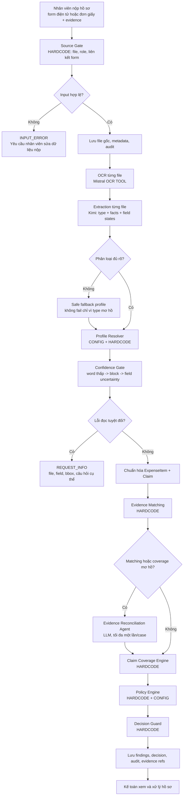

# InvoiceReferee - Workflow tác tử UC-03

## 1. Mục tiêu và nguyên tắc

Tài liệu này là workflow chuẩn cho `UC-03: Hoàn ứng và quyết toán chi phí`. Hệ thống tiếp nhận hồ sơ, đọc chứng từ, đối chiếu nguồn, áp dụng policy và chuyển hồ sơ cho đúng người. Hệ thống không tự phê duyệt, không tự giải ngân và không thay thế kế toán.

Hai kênh đầu vào phải hội tụ vào cùng một rule engine:

| Kênh | `source_type` | Nguồn khoản chi ban đầu |
| --- | --- | --- |
| Form điện tử | `DIGITAL_FORM` | Các dòng chi do nhân viên nhập có cấu trúc. |
| Đơn giấy | `PAPER_SCAN` | Các dòng chi OCR/extraction đọc từ giấy đề nghị. |

Nguyên tắc chính: kiểm tra **claim nghiệp vụ của khoản chi**, không ra quyết định chỉ vì một file thiếu một field. Một claim có thể được xác nhận bởi nhiều nguồn có source reference riêng.

## 2. Trạng thái triển khai

| Thành phần | Trạng thái |
| --- | --- |
| OCR từng file, word confidence, bbox | Đã triển khai |
| Kimi extraction và phân loại chứng từ từng file | Đã triển khai |
| Profile field theo loại chứng từ | Đã triển khai, còn quá cứng theo từng file |
| Confidence Agent một lần cho file có block confidence thấp | Đã triển khai |
| Matching evidence đơn giấy theo mã, tiền và nội dung | Đã triển khai |
| Chuẩn hóa hai nguồn vào policy dòng chi chung | Cần hoàn thiện |
| Field importance `CRITICAL/CORROBORATABLE/INFORMATIONAL` | Cần triển khai |
| Evidence Reconciliation Agent một lần có điều kiện/case | Cần triển khai |
| Decision Guard theo claim đa nguồn | Cần triển khai |

Các mục `Cần triển khai` là thiết kế đã chốt, không được mô tả như chức năng hoàn thành trong bản demo hoặc tài liệu nộp bài.

## 3. Thành phần và quyền quyết định

| Nhãn | Vai trò | Có quyền quyết định cuối? |
| --- | --- | --- |
| `HARDCODE` | Validation, matching, coverage, policy, Decision Guard | Có, theo config policy |
| `CONFIG` | Hạn mức, thời hạn, MST công ty, profile, ngưỡng confidence | Không |
| `TOOL` | OCR, parser PDF/XML/JSON, kho hồ sơ, database | Không |
| `LLM` | Kimi extraction, confidence, reconciliation khi mơ hồ | Không |
| `HUMAN` | Nhân viên, kế toán, kế toán trưởng, giám đốc | Có |

LLM chỉ đề xuất classification, facts, liên hệ evidence và câu hỏi. Code tất định tạo quyết định cuối cùng từ policy và evidence trace.

## 4. Mô hình claim

Mỗi file sau extraction đóng góp claim có nguồn gốc rõ ràng. Các claim chuẩn là `amount`, `transaction_date`, `counterparty`, `business_purpose`, `expense_item_link`, `evidence_basis`, `invoice_identity`, `item_or_service`, `advance_amount`, `settlement_difference` và `approval_or_signature`.

```json
{
  "claim_type": "amount",
  "value": "2442960",
  "state": "PRESENT",
  "confidence": 0.91,
  "document_id": "DOC-001",
  "source_refs": ["DOC:DOC-001:page-0-block-12"],
  "evidence_role": "ORIGINAL_EVIDENCE"
}
```

Document Profile không chỉ có `required_fields`. Mỗi field cần metadata `importance`, `can_be_corrobated` và `required_when`.

| Mức | Ý nghĩa |
| --- | --- |
| `CRITICAL` | Nếu claim chưa được bất kỳ nguồn nào chứng minh thì không tự xử lý. |
| `CORROBORATABLE` | Có thể mờ/thiếu trong file này nếu evidence cùng khoản chi xác nhận. |
| `INFORMATIONAL` | Không ảnh hưởng policy; chỉ lưu warning nội bộ. |

Ví dụ, MST người mua là claim cần xem xét đối với hóa đơn điện tử của doanh nghiệp. Theo policy đã chốt, thiếu MST bên mua chuyển `ACCOUNTANT_REVIEW`, không tự động yêu cầu nhân viên bổ sung trong mọi bối cảnh.

## 5. Workflow tổng thể



## 6. Pipeline từng file

Mỗi ảnh/PDF được xử lý độc lập:

```text
File gốc
  -> Mistral OCR: text + word confidence + bbox
  -> Kimi Extraction: document type, classification confidence, facts, field states, source refs, warnings
  -> Document Profile Resolver
```

Không dùng text file A để sửa OCR file B. File khác chỉ được dùng ở bước claim coverage để corroborate claim có source riêng.

Confidence Agent chỉ được gọi khi có word `< OCR_WORD_REVIEW_THRESHOLD` (mặc định `0.85`). Word confidence thấp được gom theo block; không gọi LLM cho từng word hoặc block. Input gồm loại chứng từ, confidence phân loại, vai trò file, field profile, candidate block, bbox và OCR excerpt. Output phải map block sang canonical field và trả `field uncertainty + rationale`; không được tự trả quyết định policy.

Khi classification confidence thấp hoặc có nhiều loại khả dĩ, hệ thống dùng safe fallback profile chỉ yêu cầu claim tối thiểu của nghiệp vụ. Không được áp profile nghiêm nhất của hóa đơn điện tử lên chứng từ hỗ trợ. Chỉ chuyển người nếu type mơ hồ làm `amount`, `transaction_date`, `counterparty` hoặc `evidence_basis` không thể chứng minh.

## 7. Evidence Matching và Reconciliation

Hard-code ghép evidence với expense item theo ưu tiên: (1) mã hóa đơn/số chứng từ trùng chính xác; (2) mã giao dịch, định danh đối tác hoặc vé trùng chính xác; (3) số tiền, ngày, đơn vị và nội dung cùng khớp; (4) số tiền và ngữ nghĩa nội dung gần phù hợp.

| Kết quả | Ý nghĩa |
| --- | --- |
| `AUTO_LINK` | Có dữ kiện tất định đủ mạnh. |
| `SUGGEST_LINK` | Có khả năng đúng nhưng chưa đủ để tự ghép. |
| `UNMATCHED` | Chưa có căn cứ ghép. |

`Evidence Reconciliation Agent` chỉ chạy **một lần cho toàn bộ hồ sơ** sau matching tất định khi một evidence có nhiều item ứng viên, một item có nhiều evidence, claim quan trọng mờ có nguồn khác có thể bù, hoặc diễn đạt giữa báo cáo/chứng từ quá khác nhau. Agent không chạy khi matching đã rõ, không có evidence để đối chiếu, hoặc file không đọc được/claim cốt lõi không thể extract.

Input của Agent là facts chuẩn hóa, candidate links và field uncertainties; không phải toàn bộ OCR thô. Output chỉ là đề xuất links, claim coverage, unresolved claims và rationale. Hard-code phải kiểm tra schema, source reference, score và tính nhất quán trước khi dùng output.

## 8. Claim Coverage Engine

Engine đánh giá theo khoản chi, không theo từng file.

| Tình huống | Kết quả |
| --- | --- |
| Claim critical rõ ở evidence gốc | Đạt |
| Claim critical mờ ở A, evidence ghép chắc chắn ở B xác nhận | Đạt, lưu warning nội bộ |
| Claim corroboratable không rõ nhưng nguồn khác xác nhận | Đạt |
| Claim informational không rõ | Không tạo yêu cầu bổ sung |
| Claim bắt buộc chưa được nguồn nào chứng minh | Chưa đạt |
| Hai nguồn cùng claim nhưng khác giá trị | Mâu thuẫn |

## 9. Policy chung cho form và giấy

Sau chuẩn hóa, `DIGITAL_FORM` và `PAPER_SCAN` đều phải tạo cùng contract `ExpenseItemDraft`/`ExpenseClaim` trước khi policy chạy.

| Rule | Form điện tử | Đơn giấy |
| --- | --- | --- |
| Mục đích công việc | Đọc form | Đọc đơn giấy, có thể bổ sung text nộp |
| Dòng chi/tổng tiền | Form structured | OCR/extraction bảng đơn |
| Evidence từng dòng | Nhân viên gắn file | Matching với dòng OCR |
| Evidence thay thế/ngoại lệ | Nhân viên khai lý do | Đọc ghi chú dòng; thiếu thì yêu cầu bổ sung |
| Cấm chi cá nhân/hạn mức | Policy chung | Policy chung sau chuẩn hóa category |
| Ngày chi/thời hạn nộp | Policy chung, có thể bù evidence | Policy chung, có thể bù evidence |
| Tạm ứng/chênh lệch | Policy chung | OCR rồi chạy policy chung |
| Thẩm quyền tổng hồ sơ | Policy chung | Policy chung |

Đơn giấy không được chỉ kiểm tra matching/tổng tiền mà bỏ qua danh mục, hạn mức và thời hạn nộp.

## 10. Decision Guard

| Điều kiện | Quyết định | Người nhận |
| --- | --- | --- |
| Claim bắt buộc chưa rõ, thiếu evidence, file không đọc được | `REQUEST_INFO` | Nhân viên |
| Dữ kiện đủ nhưng evidence thay thế, thiếu MST bên mua, hoặc cần kiểm tra bản gốc | `ACCOUNTANT_REVIEW` | Kế toán |
| Vượt hạn mức/thẩm quyền hoặc ngoài policy | `ESCALATE` | Kế toán trưởng/Giám đốc |
| Chi cá nhân, trùng chắc chắn, vi phạm không thể chấp nhận | `RECOMMEND_REJECT` | Kế toán |
| Claim bắt buộc đạt và không mâu thuẫn | `READY_FOR_APPROVAL` | Kế toán |

`READY_FOR_APPROVAL` nghĩa là đủ điều kiện kiểm tra tự động, không có nghĩa đã duyệt, đã ký hoặc đã thanh toán.

## 11. Số lần gọi dịch vụ

Với `F` file OCR được và `L` file có low-confidence candidate:

| Dịch vụ | Số lần logic |
| --- | --- |
| Mistral OCR | `F` |
| Kimi Extraction | `F` |
| Kimi Confidence | `L`, với `0 <= L <= F` |
| Kimi Evidence Reconciliation | `0` hoặc `1` cho toàn hồ sơ |

Tổng Kimi bình thường là `F + L + (0 hoặc 1)`. JSON repair và retry dịch vụ có thể tăng request vật lý nhưng không thay đổi số stage logic.

## 12. Audit, UI và kiểm thử

Mỗi finding hiển thị cho kế toán cần có rule ID, policy version, claim/field, lý do ngắn, file/page/block/bbox, giá trị extract, nguồn bù và câu hỏi cụ thể. Điều kiện pass/warning không cần xử lý được gom lại; lỗi chặn, mâu thuẫn và ngoại lệ phải hiển thị trước.

Regression test bắt buộc:

1. Field informational confidence thấp không tạo `REQUEST_INFO`.
2. Field corroboratable mờ có evidence khác xác nhận thì pass.
3. Claim critical mờ không có nguồn bù thì request information.
4. Hai nguồn mâu thuẫn số tiền/ngày không auto pass.
5. Type mơ hồ nhưng claim tối thiểu đủ không fail chỉ vì type.
6. Hóa đơn điện tử thiếu MST bên mua đi `ACCOUNTANT_REVIEW`.
7. Cùng khoản chi nộp form/giấy nhận cùng policy outcome.
8. Evidence thay thế có lý do đi kế toán review; không evidence/không lý do đi request info.
9. Reconciliation không gọi khi `AUTO_LINK` rõ và chỉ gọi một lần khi có ambiguity.

## 13. Ranh giới MVP

- Không xác thực danh tính/chữ ký tay.
- Không xác nhận giá trị pháp lý hóa đơn với cơ quan thuế.
- Không kết nối ERP, ngân hàng hoặc lịch sử tạm ứng thật.
- Không tự giải ngân, hoàn tiền hoặc duyệt chi.
- Hạn mức, MST công ty và danh mục cấm phải tách config, có policy version.
