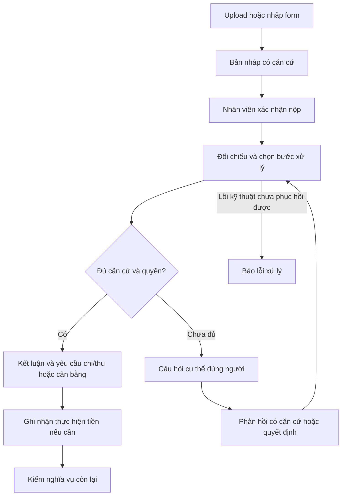

# InvoiceReferee final — Thiết kế và hợp đồng đánh giá

Ngày 15/10/2026, Asia/Ho_Chi_Minh. **DESIGN_CONSOLIDATED — Q1–Q31 và quyết định §16 đã chốt; phần triển khai phải được chứng minh riêng bằng runtime.**
**Cập nhật phạm vi:** §14 đã chốt (ACCEPTED) — thu hẹp employee-paid, lời xác nhận
có ngưỡng, ngoài phạm vi giữ nguồn, hoãn form giải trình. §15 chốt pipeline chứng cứ
OCR/phân loại/trích xuất/matching. Phần company-direct trước đó là lịch sử thiết kế;
code/contracts/gold **chưa** chuyển đổi theo phạm vi mới (do E0 và plan
finance/admissibility kế tiếp sở hữu).
Nguồn: [đề thi gốc](../Challenge_Brief_OrganizationAI_VN.docx.md), Q1–Q30 đã được người dùng chốt.
Q5 là ưu tiên chất lượng, không phải bằng chứng BTC gia hạn hoặc bỏ yêu cầu thử nghiệm.
Nhánh làm việc kiểm tra: final. Nhánh rebuild, code và quyết định của nhánh đó không là cơ sở thiết kế.
Tài liệu này thay bản hỏi–đáp lặp lại; các lựa chọn kỹ thuật của lead được ghi riêng, không giả là người dùng đã duyệt.
Chưa là implementation plan; review độc lập đã kết luận đủ để lập plan, chưa triển khai.

## 1. Mục tiêu, phạm vi và kết quả công việc

Giải quyết **quyết toán chi phí nhân viên sau hoạt động công việc**.
Hệ thống nhận hồ sơ mới, đọc và đối chiếu chứng từ, tiền, policy/quyền; tự kết luận
và tạo yêu cầu chi/thu cho routine đủ căn cứ/trong quyền. Trường hợp cần người có
câu hỏi cụ thể, đúng nhóm FACT/POLICY/AUTHORITY và người xử lý. Không yêu cầu
kế toán hay quản lý đánh giá lại eligibility của mọi routine. Thực hiện tiền thuộc
con người; app không chuyển tiền ngân hàng.

Phạm vi đã chốt:
- Một nhân viên đứng tên/một hoạt động, VND; nhiều khoản chi, nhiều tài liệu.
- Công tác nội địa trước; tiếp khách địa phương sau khi có policy/raw input/gold
  và kiểm đủ routine/FACT/POLICY/AUTHORITY, không làm hỏng invariants chung.
- Có ứng thực nhận hoặc không ứng đã xác minh; nhân viên có thể chi thêm tiền riêng.
- Bản đầu quyết toán **khoản nhân viên trực tiếp thanh toán** (xem §14, ADR006).
  Company-direct giữ như dữ kiện để đối chiếu/báo ngoài phạm vi, **không** vào phép
  tính hoàn trả nhân viên. Nhân viên trả cho nhiều khách vẫn là một claimant, không
  phải nhiều hồ sơ thanh toán cùng hóa đơn.
- Nhận nhiều lần ứng và chi/thu đã thực nhận đúng người/hoạt động/căn cứ.
  Ghi thực hiện nhiều lần một yêu cầu hợp lệ khác với phê duyệt từng phần hồ sơ còn unresolved.
- Chưa nhận ngoại tệ, hóa đơn phân bổ cho nhiều claimant/hoạt động, chuyển tiền
  giữa nhân viên, refund từ nhà cung cấp. Nguồn có những tình huống này phải được
  giữ và báo phần ngoài phạm vi; không bỏ dữ kiện để kết luận tiền.
- Không xây quy trình xin ứng trước, ký số, mua hàng/nhận hàng/tồn kho/thiết bị
  trong bản đầu. Chỉ thêm tên loại chi phí không đủ để nhận profile mới.

Ba kết quả tiền: công ty chi thêm, nhân viên hoàn lại, hoặc cân bằng đủ căn cứ.
Chi cá nhân được xác định rõ bị loại khỏi chi phí chấp nhận; không xóa tiền ứng
đã nhận hoặc nghĩa vụ thu liên quan. Tài liệu ngoài phạm vi không có nghĩa chi phí
bị kết luận sai là cá nhân/không hợp lệ; app giải thích phần chưa xử lý được.

## 2. Rulebook demo và quyền

Đây là công ty/context **synthetic**, không quy định pháp luật hay quyền của công ty thật.
Rulebook áp dụng theo profile, scope, thời hạn/version; tên case/file không là rule.

| Điều kiện | Quy tắc đã chốt |
| --- | --- |
| Hoạt động | Được tổ chức cho phép, theo quyết định riêng hoặc quy định đã ủy quyền |
| Chi phí | Phục vụ đúng hoạt động; đủ căn cứ số/người/payer/liên kết; không tính trùng |
| Ngân sách B | Ngoài phạm vi quyết định quyết toán hiện tại; B thiếu/thấp/cao không tạo gate |
| Tổng chi công việc | Giữ số chi phí đã xác minh; eligibility theo policy và quyền độc lập |
| Chi cá nhân rõ | Loại khỏi E; vẫn xử lý nghĩa vụ ứng thực nhận |
| Dữ kiện nghi vấn | FACT; không khẳng định tiền khi căn cứ trọng yếu chưa giải quyết |
| Quyền tự công nhận E | E <= 8.000.000 đ |
| Quyền tự tạo yêu cầu chi/thu | abs(S) <= 4.000.000 đ |
| Người quyết định demo | Công nhận chi phí/yêu cầu chi thu <= 20.000.000 đ theo đúng action/scope/profile/thời hạn |
| Trên quyền demo | Nêu cần cấp có quyền ngoài demo; không giả có người đủ quyền trong app |

8/4/20 triệu là tham số demo được người dùng chọn để kiểm ba ranh giới, không
benchmark hay mức được nghiên cứu là tối ưu. 8 triệu là quyền tự công nhận E,
không phải ngân sách. Boundary gồm dưới/bằng/trên mỗi hạn mức; grant còn cần actor, hành động, người/
hoạt động/profile và thời hạn. Policy phù hợp nhưng grant thiếu/hết hạn/sai scope
là AUTHORITY; một hồ sơ có thể đồng thời FACT/POLICY/AUTHORITY.

Ví dụ: E12/A11 triệu, các dữ kiện khác đủ: S=1 triệu nhưng E vượt quyền tự công
nhận 8 triệu, phải AUTHORITY dù không có B. Người đủ quyền quyết định đúng hồ sơ,
không tự đổi rulebook cho mọi hồ sơ. Xác nhận sau khi chi giữ đúng thời điểm,
không giả thành cho phép trước.

Ngữ cảnh profile:
- Công tác: mục đích, nơi đến, thời gian và liên hệ khoản chi với hoạt động.
- Tiếp khách địa phương: ngày, mục đích công việc, tổ chức/nhóm khách và liên hệ
  khoản chi. Không đòi itinerary, registry đối tác hay cap đầu người mặc định.
- Tiếp khách trong chuyến có thể là một khoản thuộc hồ sơ công tác; không claim
  lần hai qua profile khác. Cap theo loại chi phí chỉ tồn tại nếu policy hiệu lực quy định.

Acceptance cho quyết định ngoại lệ: ghi rõ policy/rule được ngoại lệ, hoạt động,
khoản/số tiền và thời điểm/người có grant phù hợp; kiểm các điều kiện khác còn lại.
Một lời “đồng ý” không tự giải quyết nguồn tiền/quan hệ còn nghi vấn.

## 3. Tiền và căn cứ

| Ký hiệu | Nghĩa |
| --- | --- |
| T | Tổng chi công việc thực tế đã xác minh trong scope, không đồng nhất với eligibility E |
| E | Phần chi phí đủ điều kiện nhân viên thực tế đã trả |
| C | Phần chi công việc công ty trả trực tiếp; giữ để đối chiếu/báo ngoài phạm vi, không hoàn lại cho nhân viên |
| A | Tổng ứng công ty đã thực trả và nhân viên đã thực nhận |
| P | Tổng tiền công ty đã thực hoàn trả cho nhân viên trong quyết toán |
| R | Tổng tiền nhân viên đã hoàn và công ty đã thực nhận, thuộc ứng/quyết toán của scope này |
| S | E − A − P + R: dương chi thêm, âm thu lại, bằng 0 cân bằng khi đủ căn cứ |

Đây là biểu diễn gross events trong scope Q28; mỗi R giữ loại/lý do và giao dịch
liên quan, không gộp mất provenance. Refund từ nhà cung cấp nằm ngoài R/scope này.
T không mặc định E+C: khoản chi công việc có thể cần ngoại lệ hoặc không được
hoàn trả; không cắt T về E. Không trừ C lần nữa khỏi E.

Integer VND cho quyết định; tiền nguồn có đơn vị/currency và quy tắc chuẩn hóa.
Nếu nguồn cần phép nhân/làm tròn, dùng Decimal có giới hạn, không float.
Chỉ số 0 được xác lập mới vào phép tính. Không thấy giấy ứng không chứng minh A=0.

Căn cứ:
- Lời khai mục đích/liên hệ công việc có thể được policy nhận khi không mâu thuẫn.
- Tiền/payer/received cần chứng từ hỗ trợ hoặc xác nhận có trách nhiệm, đúng phạm
  vi, có người/căn cứ/thời điểm. Hóa đơn không tự chứng minh người thực tế trả.
- **Chốt 14/10/2026 (policy demo):** một hóa đơn gốc hợp lệ gắn đúng nhân viên và hồ
  sơ được chấp nhận làm căn cứ khoản nhân viên đã trả (`EMPLOYEE_PAID_INVOICE`), không
  cần giấy xác nhận thanh toán riêng. Đây là giả định nghiệp vụ cho demo, không phải
  xác minh ngân hàng và không tạo giao dịch ngân hàng giả; view ghi rõ mức căn cứ.
- Khoản ứng thực nhận vẫn cần bản ghi riêng của công ty; đã duyệt ứng không tự thành
  đã nhận. Kế toán ghi nhận `ADVANCE_RECEIVED` từ chứng từ ứng đã đọc.
- A/P/R=0 cần lịch sử đủ scope/mốc đối chiếu hoặc xác nhận coverage có trách nhiệm.
- Facts đọc đúng không tự chứng minh relation người/hoạt động/hóa đơn/giao dịch đúng.
- Nguồn và lời khai mâu thuẫn trọng yếu giữ unresolved; không chọn theo model confidence.
- Một loại document.role thuộc từng tài liệu; đề nghị và bảng kê khác loại không là conflict toàn hồ sơ.

Acceptance history coverage: scope người/hoạt động, mốc đối chiếu, loại dòng tiền
và số dư đầu kỳ/tồn trước nếu có phải được phủ. Có giao dịch trong tháng không
chứng minh không có ứng trước tháng đó; thiếu coverage vẫn FACT. Xác nhận coverage
có actor/căn cứ/phạm vi/thời điểm, khác câu trả lời “không thấy giao dịch”.

Với hoạt động `PROPOSED`, một `ActivityAcceptance` riêng có thể ghi nhận kế toán
đã xác minh công việc được công ty chấp nhận qua chứng từ ứng hoàn tất, đúng người
và đúng hoạt động. Nó không đổi trạng thái hoạt động, không cấp grant và không
thay policy/coverage.

## 4. Người dùng và luồng nghiệp vụ

| Vai trò | Trách nhiệm |
| --- | --- |
| Nhân viên | Nộp hồ sơ, khai báo/bổ sung hoạt động và thông tin mình biết |
| Kế toán | Xác minh tiền/lịch sử; thực hiện và ghi nhận chi thu có căn cứ |
| Người có quyền | Quyết định ngoại lệ/vượt grant trong phạm vi được cấp |

Quyền xác nhận fact khác quyền quyết định ngoại lệ. Persona demo không là danh
tính thật đã xác thực; role client/tên/chữ ký scan không tự cấp quyền server.

1. Upload PDF/PNG/JPEG nhiều tệp là luồng chính; form bổ sung/nộp trực tiếp dùng
   cùng contract và pipeline. Context tổ chức có sẵn không bắt nhân viên nhập lại.
2. AI tạo bản nháp có source refs. Nhân viên xem/sửa/xác nhận nộp; giữ correction
   khác nội dung nguồn. Field chưa rõ không ép điền số đoán.
3. Sau nộp, hệ thống tự xử lý các bước phụ thuộc và giữ phần đã rõ. Nguồn không đổi
   được dùng lại hợp lệ; không gọi OCR chỉ vì xác nhận bản nháp.
4. Routine đủ căn cứ: lưu kết luận + yêu cầu chi/thu có thể thực hiện. S=0 có kết
   luận cân bằng, không tạo yêu cầu số 0.
5. Có issue: câu hỏi chứa dữ kiện đã biết, nguồn liên quan, phần thiếu/quyết định
   cần, người xử lý và ảnh hưởng. Câu hỏi phải trả lời được, không “xem xét lại”.
6. FACT trước nếu POLICY/AUTHORITY phụ thuộc số chưa rõ; issue độc lập có thể hỏi
   song song, nhóm theo người. Không gửi trùng; basis đổi làm câu hỏi cũ hết hiệu lực.
7. Phản hồi có kiểu/căn cứ/phạm vi/người/thời điểm. Kiểm đủ căn cứ/quyền, recheck
   phần phụ thuộc và mọi gate trước action; nhận câu trả lời chưa tự resolved.
8. Kế toán nhận danh sách yêu cầu còn hiệu lực: người, chiều/số tiền, lý do/căn cứ.
   Thực hiện tiền ngoài app, rồi ghi nhận kết quả/chứng từ; không sửa instruction
   trực tiếp để né recheck.
9. Kế toán bổ sung chứng từ ứng vào hồ sơ hiện có. Backend giữ tệp và bản đọc;
   mã hồ sơ rõ có thể liên kết tự động, còn trường hợp không đủ phân biệt thì kế
   toán xác nhận đúng hồ sơ và nêu căn cứ. Mâu thuẫn tham chiếu giữ nguyên conflict.
10. Kế toán xác nhận riêng lịch sử tiền theo hồ sơ: kỳ, quỹ, loại dòng tiền, số dư
    đầu kỳ, chứng từ căn cứ, lý do và mốc hệ thống ghi. Chứng từ ứng không tự tạo
    coverage; giao dịch mới hoặc backdated làm coverage của hồ sơ stale.
11. Hoàn thành đối soát khác hoàn tất nghĩa vụ tiền. Hoàn tất cần history đủ, S=0,
   không issue/pending/yêu cầu chưa thực hiện/execution chưa rõ/Stop chưa giải quyết.
   Không thêm lần duyệt eligibility chỉ để kết thúc routine đã đủ điều kiện.

## 5. Kiến trúc ứng dụng và AI

Đã chốt: Python/FastAPI/Pydantic, SQLite + artifact directory,
React/TypeScript/Vite; Mistral OCR, xkiro LLM. Workflow Python tường minh,
chưa dùng LangGraph. Một app cho pilot khoảng 5 người; không microservices,
queue ngoài, generic agent platform, bank integration hay enterprise identity.

| Module | Interface chính | Trách nhiệm bên trong |
| --- | --- | --- |
| EvidenceReader | read(source, requested_fields, budget) | Native PDF/OCR/LLM, observations/locators, validation, giới hạn và trace |
| Reconciler | assess(snapshot, observations, relations) | Logic pure: applicability/quality/math/policy/grant/duplicate/issues |
| CaseWorkflow | draft / submit / process / answer / control / record_execution / view | Orchestration, persistence, versions/transactions, actors, actual events/instructions/audit |
| EvaluationRunner | evaluate(packet, mode) | Chạy cùng đường ứng dụng, setup isolated context, scoring độc lập, local artifacts/LangSmith |

Đây là decomposition do lead đề xuất để thực hiện quyết định đã chốt; module
không đồng nghĩa một file. CaseWorkflow có helpers nội bộ theo responsibility,
không nhồi mọi SQL/rule/API vào một lớp. Không tạo storage abstraction cho tương
lai khi chưa có consumer/adapter khác thật. Frontend hiển thị server view và gửi
ý định; không viết lại phép tính tiền/quyền trong React.

Giữ riêng Source, Observation, Relation, Declaration/Confirmation, Assessment,
Decision/Instruction và MoneyEvent. Observation có raw/normalized value, unit,
source locator/read state/origin; refs phải tồn tại và thực hỗ trợ mệnh đề.
Source instruction độc hại là dữ liệu, không policy/tool instruction.

AI chọn trong tập hẹp: đọc trang/trường, đối chiếu nguồn sẵn có, một bước phục hồi
có lý do hoặc hỏi đúng người. Backend thực thi dưới budget, kiểm output/nguồn/
quan hệ/tiền/quyền/state. LLM không có tool cấp grant, đổi policy, chuyển ngân
hàng hoặc trực tiếp commit action.

Một lượt đọc ban đầu, tối đa một bước đọc/đối chiếu bổ sung mỗi issue trong budget
chung. Không có nguồn/hành động đáng thử thì hỏi người; không gọi lại để lấy model
đồng thuận. Timeout/API/schema lỗi là lỗi kỹ thuật sau xử lý giới hạn, không giả
ngoại lệ nghiệp vụ hoặc khẳng định kết quả. Các issue nghiệp vụ độc lập vẫn hiện.
Các giới hạn run/calls/time/usage cần đo M0; công bố ceiling trước calls, không giả
chất lượng hoặc latency từ thiết kế. Exact models/dependency versions chốt theo M0.

## 6. State, transactions, Stop và Override

Case version bảo vệ mutation; input revision ghi thay đổi material; decision basis
ghi facts/relations/policy/grant phụ thuộc; control state chặn worker đến muộn.
Một status SUCCEEDED của run không đồng nghĩa đủ điều kiện hay tiền đã nhận.

Command có ID chống lặp và version; mất response sau commit trả cùng kết quả khi
gửi lại cùng command ID. Backend quản lý batch upload/đọc, không để UI nối các
mutation bằng version cũ. Provider calls ngoài transaction; commit tiền/action/
reservation/audit trong transaction ngắn, kiểm basis/quyền/Stop/duplicate hiện tại.

Chống trùng gồm command, copies nguồn và cùng nghĩa vụ qua hồ sơ/profile/representation
khác. Byte hash hoặc amount/date không đủ. Economic identity + usage/reservation
được kiểm tại commit; uncertainty là FACT. Hai worker không cùng giữ một nghĩa vụ.
Scenario cross-dossier phải thực sự gồm hai hồ sơ trong một không gian kiểm thử.

Chứng từ thực hiện chỉ fulfill nghĩa vụ đúng: cập nhật actual/remaining; nếu sửa
payer/amount/proof/scope trọng yếu: recheck kết luận. Ghi thực hiện nhiều lần hợp
lệ cập nhật số còn lại của yêu cầu; không phát hành trùng instruction cho số còn lại.

Stop có thứ tự rõ với commit: trước commit chặn; sau commit giữ lịch sử và tạm
ngừng yêu cầu chưa thực hiện. Worker muộn không tạo quyết định hiệu lực. Resume
kiểm basis hiện tại. Yêu cầu đã bàn giao/execution chưa rõ cần xác minh trước
thay thế và giải phóng usage; app không hủy giao dịch ngân hàng ngoài app.

Override tạo quyết định mới đúng quyền/căn cứ/lý do, giữ gốc. Không thay số nghi
vấn thành fact hoặc xóa actual event; tiền thật đã xảy ra được ghi và đối chiếu,
không từ chối ghi chỉ vì trái yêu cầu. Sai người/quá tiền/chưa rõ phải thành issue,
không được tính là fulfillment hợp lệ hay tự phát hành yêu cầu bù thiếu căn cứ.

Audit local ghi actor/action/time/input/policy/grant/source/reason và before/after.
Không phụ thuộc LangSmith để kiểm toán nghiệp vụ; không tuyên bố chống tuyệt đối
thực hiện tiền trùng bên ngoài app.
Decision giữ exact versions hoặc snapshot/hash để truy lại policy/grant/input
đã dùng, không chỉ trỏ tới file context mutable mới nhất. Test sửa policy/grant
sau một decision phải vẫn tra được căn cứ lịch sử đúng của decision đó.

## 7. Chuyển tiếp và học từ feedback

| Nhóm | Vấn đề | Người/hành vi |
| --- | --- | --- |
| FACT | Số/người/payer/history/relation thiếu, chưa rõ hoặc conflict | Người xác minh được fact đó; giữ căn cứ và phần bị chặn |
| POLICY | Ngoài quy định/chưa bao phủ/vượt hạn mức loại chi | Người được phép quyết định ngoại lệ nếu policy cho đường đó |
| AUTHORITY | Policy phù hợp nhưng grant thiếu/sai/hết hạn/vượt mức | Người có quyền đúng scope/cost/action |
| TECHNICAL | Provider/config/timeout/schema lỗi | Báo lỗi xử lý riêng, không tính là business escalation đúng |

Không chi thu từng phần khi issue còn lại có thể đổi kết luận chung. Khoản cấm rõ
không có ngoại lệ có thể tự loại khi đủ căn cứ; không erase nghĩa vụ ứng.

Chỉ học ngưỡng chọn thử recovery được Q17 cho phép hoặc hỏi người ngay. Features
quan sát được như representation/text presence/issue/nguồn thay thế/budget còn.
Ước lượng bước phục hồi hữu ích không thay evidence quality; không học grant/
điều kiện chứng cứ hoặc bỏ conflict. Phải chứng minh routing thay đổi và recovery
đúng, không chỉ đổi số calls. POLICY/AUTHORITY vẫn theo policy/grant.

Feedback tùy chọn gắn run/câu hỏi/kết quả: đúng/sai, hỏi thừa/sai người và căn cứ.
Giữ riêng correction, ngoại lệ và đánh giá agent; nhãn chưa kiểm chỉ là nhận xét,
không calibration. Không suy nhãn đúng từ nút đồng ý, im lặng hoặc override.

Cập nhật theo đợt: tự chọn candidate threshold trên nhãn đã kiểm, validation
riêng dưới cùng model/policy/budget; kích hoạt khi không tăng dangerous misses/
chuyển thừa và có cải thiện routing hoặc tự hoàn thành đúng. Lưu version/results/
rollback. Guard tiền/nguồn/quyền giữ nguyên. Thiếu dữ liệu/support giữ fixed policy.
Công thức/nhóm features/N tối thiểu là lựa chọn kỹ thuật phải được công bố và kiểm,
không tự tuyên bố đủ bằng 15 development hay 20 holdout.

Origin SIMULATED/INTERNAL_USER/PROFESSIONAL_USER ghi đúng. Simulated chỉ chứng minh
cơ chế; internal human feedback thật có thể chứng minh hoạt động học trên dữ liệu
synthetic, không thay >=3 professional trials. Hiện người dùng chưa có feedback.
Không claim tác động doanh nghiệp hay đạt toàn Sprint2 vì đã thiết kế cơ chế.

## 8. Đánh giá độc lập và Verify

| Tập/lớp | Nội dung và vai trò |
| --- | --- |
| Development | >=15 raw dossiers, routine/FACT/POLICY/AUTHORITY, gold trước output engine |
| Calibration/validation | Feedback đã kiểm, chọn và kiểm ngưỡng theo Q20–Q21, không trộn holdout cuối |
| Holdout pilot | 20 hồ sơ độc lập ban đầu, 10 routine/10 human; báo số đếm và phạm vi |
| Technical/control | Provider/malformed output/non-document, races/duplicate/Stop/crash/basis/Override |
| Core4 | 4 case công bố, ít nhất một reject/escalation, một thao tác |
| Escalation5 | 3 routine + 2 human, một thao tác, câu hỏi/nhóm/người rõ |
| User trials | >=3 người trực tiếp làm nghiệp vụ, feedback thật, before/after và thay đổi từ feedback |

Gold gồm raw nguồn, facts/locators/quality, relations, company history coverage,
policy/grants, expected amounts/route/owner/questions/persisted actions/state sequence.
Expected chỉ scorer đọc sau application; không vào prompt/branch theo case ID/
filename. Bộ chấm code dùng literal oracle, không Reconciler tự chấm chính nó.
LLM judge chỉ bổ trợ câu hỏi/giải thích sau hiệu chuẩn human rubric false-pass/
false-fail; không chấm quyền/tiền để quyết định pass.

Verify/UI dùng cùng CaseWorkflow/Reconciler; output từ DB/state, mode/timestamp,
expected vs actual và refs. Case độc lập có initial context/DB riêng; cross-case
duplicate có nhiều dossiers trong cùng scenario. Ba routine phải chứng minh công
việc đầy đủ và nguồn khác nhau có ý nghĩa, không chỉ đổi dấu tiền.

Inventory development ban đầu (chưa tạo packets):
| ID | Scenario | Kỳ vọng |
| --- | --- | --- |
| D01 | Company-direct3/E5/A2 triệu, nguồn/quyền đủ | CHI3, một instruction, không hoàn C |
| D02 | Số rõ nhưng relation người/hoạt động chưa đủ | FACT, không ghép chỉ vì tên/amount |
| D03 | E=A=2 triệu, đủ history | BALANCED, không instruction số 0 |
| D04 | E12/A11, đủ nguồn nhưng E vượt grant8 | AUTHORITY dù S1 |
| D05 | Tiếp khách địa phương E0,7/A0 xác minh | CHI0,7, không đòi itinerary |
| D06 | T10>B8 là căn cứ duy nhất | FUTURE SCOPE; giữ nguyên oracle, loại khỏi mẫu hiện tại |
| D07 | E9/A6, vượt quyền tự công nhận E8 | AUTHORITY |
| D08 | Grant travel-only/hết hạn cho tiếp khách | AUTHORITY |
| D09 | Procurement/nghiệm thu hoặc refund nhà cung cấp ngoài scope | Báo phần ngoài phạm vi, không khẳng định nghĩa vụ |
| D10 | History coverage thiếu | FACT kế toán, không A/P/R=0 |
| D11 | E1,5/A2; variant E2/A2, history đầy đủ | THU0,5 hoặc cân bằng, không giả đã thu |
| D12 | Nhiều actual payments đúng scope và hai payer | T/E/S/remaining đúng, không tính trùng |
| D13 | Cùng hóa đơn PDF/ảnh qua dossiers/profiles | Economic identity/usage đúng; uncertainty giữ FACT |
| D14 | Critical source/declaration conflict hoặc trường mờ | FACT/unknown, không chọn confidence |
| D15 | Khoản cá nhân rõ, history A=0; variant A>0 | Loại khoản có căn cứ; ứng đã nhận vẫn phải đối chiếu |

Technical/control có bộ riêng, không gộp timeout thành nhãn human. Case second
profile chỉ chạy khi gate mở đã đạt; >=15 hồ sơ vẫn phải được đáp ứng cho profile
thực nhận trước khi claim. Variants/ảnh clone không tự là hồ sơ độc lập.

Split theo hoạt động/nghĩa vụ/tài liệu gốc và family/layout/issuer phù hợp; cùng
invoice/template đổi số không chứng minh tổng quát trên mẫu mới. Nếu dùng holdout
để chỉnh, lưu kết quả failure, chuyển nó thành development và dùng tập mới báo cáo.
Gold synthetic chỉ chứng minh trong rulebook demo; 20 không là đủ support thống kê
để claim toàn doanh nghiệp hoặc đủ nhãn adaptation.

Metrics báo count/denominator trước phần trăm:
- Miss = human-required được tự phát hành action / tổng human-required.
- Chuyển thừa = routine đủ căn cứ/quyền bị hỏi không cần thiết / tổng routine.
- Đúng nhóm/owner/câu hỏi; routing thiếu/sai owner báo riêng với unsafe action.
- Auto completion đúng / tổng routine; completion/failures trên toàn input.
- Critical exactness/false-known, relation accuracy; ref tồn tại AND hỗ trợ mệnh đề.
- Đúng E/T/S/người/chiều/basis, instruction/actual/remaining và state transitions.
- Calls/usage/latency, số câu hỏi/tra lại/sửa; trước và sau human assistance tách riêng.

Lỗi kỹ thuật giữ trong completion denominator; không drop failed run để làm đẹp
routing. Retry không thêm independent case. N=0 là chưa xác định, không 0%/100%.
Missing usage không là 0; cost chưa có giá/usage đủ thì báo chưa xác định.

Release gates đã chốt:
- Không critical false-pass về tiền/người/quyền/nguồn/duplicate/Stop/stale/history.
- Core4/Escalation5 đúng mọi expected, không bypass pipeline.
- Holdout mục tiêu 0/10 missed human và 0/10 chuyển thừa, đúng money/refs/owner/action,
  không chỉ nhãn. Zero quan sát trên mẫu nhỏ không là đảm bảo zero risk.
- Latency/calls/budget được M0 chốt trước quy mô lớn/publicdemo, ghi distribution/N.
- Adaptation đạt validation/support/gates mới activate; nếu không giữ fixed policy.
- Claim Sprint2/impact cần >=3 professionals, phản hồi thật và ít nhất một cải tiến.
  Hiện chưa có, không thay bằng reviewer AI hoặc feedback bịa.

## 9. LangSmith, model và observability

LangSmith dùng tracing/experiments/custom scoring, không cần LangGraph.
Trace read/OCR/extract/relation/recovery/check/escalation/commit outcome có
run/case/input/policy/prompt/model version; human resume liên kết cùng dossier,
không giả một trace chứa nguyên vòng đời. LangSmith xanh không chứng minh commit
đúng. Local audit/Verify/export chạy khi tắt hoặc lỗi LangSmith; telemetry không
thay kết luận. Chọn lọc/che payload và metadata trước gửi, không mặc định gửi bank
PDF/secrets/private raw data. Một bộ scorer dùng local và báo kết quả lên dashboard.

M0: một model baseline thật khả dụng, PDF text/scan rõ/scan nghi vấn/non-document,
schema/refs/output/latency/usage/errors. Sau đó so một ứng viên khả dụng khác cùng
development/policy/pipeline; chọn critical facts/relations/routing/completion trước
latency/usage. Không dùng holdout chọn model, không claim hỗ trợ strict schema/tool
roundtrip qua xkiro trước kiểm. Pin exact version/config; không mặc định latest.

## 10. Demo, setup và giao diện

Public URL không signup theo brief; persona mẫu và dữ liệu tách phiên. Server
cấp quyền demo đã cấu hình; không trust role tự gửi, không xác thực quyền pháp lý.
Rulebook/company context/raw mẫu/runbook nằm trong repo; không phụ thuộc private
upload/local DB/file ignored. Secrets riêng, .env.example không secret; missing
key báo rõ. LIVE/replay/rule tests được ghi mode, không âm thầm fallback.

Một entry command và runbook clone-clean; kiểm backend/frontend/config/data mới.
Upload/calls có giới hạn, reset đúng sandbox, không xóa session người khác.
Exact hosting/TTL/limits/versions là lead chọn trong ràng buộc và cần kiểm thực tế;
chưa có URL/publicdeploy hoặc kết quả M0, chưa cài dependency.

Giao diện theo trách nhiệm Q14: nộp/theo dõi/trả lời; xác minh/thực hiện tiền;
quyết định ngoại lệ. Trình bày tên hoạt động/người/số tiền/việc cần làm/căn cứ.
Run IDs/enums/epochs/trace ở chi tiết kỹ thuật, không lấn nội dung nghiệp vụ.
Technical error nói lỗi xử lý và hành động tiếp theo, không false “đủ điều kiện”.
Layout/chi tiết component do lead thiết kế, kiểm qua UI khi code; chưa có mockup được duyệt.

## 11. Bằng chứng cuộc thi, ranh giới và bước tiếp theo

| Yêu cầu đề A/brief | Bằng chứng phải thực hiện |
| --- | --- |
| Routine tự động, không khẳng định nguồn nghi vấn | Decision/instruction đúng + control/unknown cases |
| >=15 cases, 3 nhóm, câu hỏi cụ thể | Raw/gold/rulebook và Verify/results, không inventory thay dataset |
| Core4/Escalation5/new inputs | Một thao tác/mode/timestamp/cùng pipeline, không case hardcoding |
| Adaptive thresholds | Verified feedback -> candidate -> validation -> changed routing đúng |
| >=3 practitioners/impact | Nhân sự thật/consent/raw feedback/before-after/change/bất cập |
| HITL/audit/Stop/Override | Action bất kỳ tra được ai/lúc nào/input/lý do và can thiệp thực |
| Live URL/clean clone | Public runtime và runbook đã tái lập |
| Public history/slide/video/build log | Lịch sử không squash/force-push; 5 slides, video<=3min, log1page |

MVP5 người khác giới hạn đội1–4 sinh viên. Lịch brief: khóa15/10, demo17/10;
ưu tiên chất lượng không xác nhận gia hạn. Yêu cầu người thật không được miễn vì
coding agent nhanh. Hiện chưa tạo app/gold/results/publicdemo/professional feedback;
docs/reviewer agreement không là runtime verification.

Người dùng đã duyệt nội dung Q1–Q30; bản thống nhất đã qua builder/contest review
và được trình để làm căn cứ implementation plan. Những chi tiết lead
có thể tự chọn trong ràng buộc: package layout/helpers, framework testing/UI,
exact adapters/versions sau kiểm, finite initial ceilings, equation representation,
scorer implementation và hosting. Chọn model/limits sau M0 phải có số liệu; đo là
bước công việc, không tự biến thiết kế thành kết quả đã đạt.

Nếu review phát hiện quyết định mới làm đổi phạm vi hoặc quyền, hỏi người dùng
với đề xuất cụ thể; không hỏi lại Q đã chốt. Builder phải bảo toàn invariants
trên và không lấy nhánh rebuild làm kiến trúc. Chưa commit/push/publish hay gọi API.

Review độc lập ngày13/10: subagent Helmholtz, GPT6 Web High, đọc thiết kế/đề gốc,
verdict **READY FOR IMPLEMENTATION PLANNING**, không nêu quyết định trọng yếu cần
mở Q31. Các điểm history coverage/ngoại lệ/audit version/đủ15 hồ sơ công tác được
ghi thành acceptance trong tài liệu. Đây là verdict thiết kế, không proof app
vận hành hay đủ điểm thi. Kiểm của lead: relative links/whitespace/inventory15,
7 ví dụ tương đương biểu diễn gross money; không chạy unit/UI/LIVE app tests.

Tài liệu liên quan:
[Glossary](../../GLOSSARY.md),
[ADR001](../adr/0001-rebuild-on-final.md),
[ADR002](../adr/0002-bounded-settlement-autonomy.md),
[ADR003](../adr/0003-travel-and-client-meeting-scope.md),
[ADR004](../adr/0004-python-react-application-stack.md),
[ADR005](../adr/0005-explicit-python-workflow.md).

Nguồn kỹ thuật đã đọc (không thay M0):
[LangGraph interrupts](https://docs.langchain.com/oss/python/langgraph/interrupts),
[SQLite isolation](https://sqlite.org/isolation.html),
[xkiro structured output](https://docs.xkiro.com/guides/structured-output/),
[LangSmith tracing](https://docs.langchain.com/langsmith/observability-quickstart),
[custom evaluation](https://docs.langchain.com/langsmith/evaluate-llm-application),
[mask trace data](https://docs.langchain.com/langsmith/mask-inputs-outputs).

## 12. Quyết định lịch sử sau review độc lập mở rộng — Q31

Phần diễn giải B dưới đây phản ánh quyết định ngày 13/10/2026. Người dùng đã
thay đổi phạm vi ngân sách vào 15/10/2026; §16 và ADR0009 là quyết định hiện hành.

Ngày13/10 người dùng chốt B giới hạn **chi phí công việc đã phát sinh và được xác
minh**, không chỉ phần tiền đã thanh toán. Đây là nghĩa của T ở mục3. T không tự
đồng nhất với face value hóa đơn nếu dịch vụ/nghĩa vụ còn tranh chấp hoặc chưa
được xác lập. E vẫn là phần nhân viên thực trả đủ điều kiện; C là công ty thực
trả trực tiếp; unpaid không tự vào E/C. S=E−A−P+R không đổi.

Ví dụ dịch vụ10 đã cung cấp/nghĩa vụ xác minh, employee paid5/company paid3/unpaid2:
T10 vẫn là tổng chi thực tế; khoản chưa trả không mở vendor-payable workflow.

[Review mở rộng/disposition](reviews/2026-10-13/SYNTHESIS.md) chỉ ra các contract
và acceptance cần khóa trước giao coding agent; verdict ready ở vòng trước không
thay được chúng. Chưa áp toàn bộ findings, chưa viết implementation plan hoặc app.
Ba báo cáo gốc và đính chính giữ nguyên; snapshot review là prefix430 dòng của
tài liệu này, SHA tại [index review](reviews/2026-10-13/README.md).

## 13. Trạng thái implementation plan sau review — 13/10/2026

[Plan 13 tasks](../superpowers/plans/2026-10-13-invoice-referee-final.md) và
[implementation contracts](IMPLEMENTATION_CONTRACTS.md) đã được viết và sửa sau
[review/disposition](reviews/2026-10-13-plan/SYNTHESIS.md). Các status “chưa viết
plan” ở các snapshot trên là lịch sử tại thời điểm review. Q1–Q31 không đổi.
Chưa triển khai app, chạy unit/UI/LIVE hoặc thu professional feedback trong lượt
planning. Coding agent đọc spec + contracts + plan; review archive là căn cứ khi
cần tra tranh luận, không là tập instructions phải nạp toàn bộ.

## 14. Thu hẹp hồ sơ và policy đầu vào — cuộc grill 13/10/2026

Trạng thái: **ACCEPTED (14/10/2026)**. [ADR006](../adr/0006-employee-paid-scope.md)
và [ADR007](../adr/0007-money-confirmation-basis.md) ghi phần đã chốt; code/contracts/
dataset/gold vẫn **chưa** thay đổi. Những khẳng định về implementation ở §13 là
snapshot lịch sử, không phải kết quả kiểm tra checkout hiện tại.

Đã chốt trong trao đổi:
- Bản đầu quyết toán khoản nhân viên trực tiếp thanh toán cho hoạt động; không
  hỗ trợ công ty thanh toán trực tiếp nhà cung cấp. Giữ tạm ứng/hoàn tiền/thu lại
  giữa công ty và nhân viên; nguồn tiền nhân viên trả có thể là ứng hoặc tiền riêng.
- Dùng bố cục gen_1.py làm tham khảo, thay nội dung/đáp án theo phạm vi hệ thống;
  không lấy nguyên policy hoặc code của nguồn khác.
- Hồ sơ gồm đề nghị/bảng kê và chứng từ dịch vụ; tạm thời không bắt upload file
  chứng minh thanh toán riêng. Không đồng nhất quyết định bỏ file với quyết định
  tự công nhận lời khai đủ căn cứ phát hành yêu cầu chi/thu.
- Không yêu cầu giấy giải trình trong bộ nộp ban đầu. Người dùng yêu cầu hoãn
  phần giải trình để phát triển sau; chưa chốt bỏ cả câu hỏi/chuyển tiếp.

Đã chốt vòng 14/10/2026 (thay cho danh sách "cần chốt" trước đó):
- **Q32 — Policy lời xác nhận chi tiền:** chấp nhận lời xác nhận chịu trách nhiệm
  của nhân viên cùng chứng từ dịch vụ làm căn cứ xử lý routine khi các điều kiện
  khác đủ và không có mâu thuẫn trọng yếu; hiển thị đúng mức căn cứ, không gọi là
  đã xác minh giao dịch ngân hàng. Ngưỡng: trong giới hạn tự xử lý hiện có
  (`E<=8tr`, `abs(S)<=4tr`); vượt ngưỡng vẫn AUTHORITY. Chi tiết và rủi ro ở
  [ADR007](../adr/0007-money-confirmation-basis.md).
  **Cập nhật 14/10/2026 (sau grill):** đường mặc định của hồ sơ routine nay là
  **hóa đơn hợp lệ gắn đúng nhân viên/hồ sơ** (`EMPLOYEE_PAID_INVOICE`), không cần
  lời xác nhận thanh toán riêng; Q32 trở thành đường phụ có ngưỡng. Xem §3 "Căn cứ"
  và [ADR007](../adr/0007-money-confirmation-basis.md) "Chốt vòng 14/10/2026".
- **Q33 — Giới hạn hoãn giải trình:** hoãn form giải trình tự do; giữ khả năng nêu
  vấn đề/câu hỏi cụ thể, đúng người xử lý, cho sửa khai báo/bổ sung nguồn và kiểm
  lại. Không tự kết luận đủ điều kiện cho nguồn thiếu/mâu thuẫn trọng yếu. Đường
  `AnswerIssue` hiện có vẫn giữ.
- **Q34 — Nguồn ngoài phạm vi employee-paid:** khi tài liệu cho thấy công ty trả
  trực tiếp hoặc người trả thuộc bên khác, giữ nguồn và báo phần ngoài phạm vi;
  không ép thành khoản nhân viên đã trả, không bỏ phần vật chất để kết luận tiền.
  `C` giữ như dữ kiện để đối chiếu/báo, không vào phép tính hoàn trả nhân viên.

Hệ quả dữ liệu (kịch bản lịch sử; điều kiện B superseded bởi §16):
- D01 routine: nhân viên khai đã trả khách sạn4.320.000 + taxi680.000 =5 triệu;
  ứng thực nhận2, history P/R đủ và bằng0; đề nghị chi3 khi policy/quyền/căn cứ đủ.
  B8 từng là dữ liệu fixture cũ, không còn là precondition; kết quả tài chính không đổi.
- Nếu giữ chi8 và chuyển toàn bộ thành nhân viên trả, A2 =>S6; vượt quyền tự tạo
  yêu cầu4. Không giữ đáp án chi3 của dữ liệu cũ sau thay đổi đó.
- D01/D06/D15 cùng các case có company-direct cần rà soát lại nguồn, T/E, budget,
  route, gold và bộ chấm. Không xóa/ghi đè dữ liệu trong lượt này.

Bước tiếp theo: E0 promote các quyết định này vào contracts; pipeline chứng cứ ở §15
triển khai trước, việc map chứng cứ → finance/admissibility thuộc plan kế tiếp.

## 15. Pipeline chứng cứ OCR/phân loại/trích xuất/matching — chốt 14/10/2026

Trạng thái: **ACCEPTED**. Nguồn: [biên bản OCR/matching](reviews/2026-10-13/ocr-input-policy-discussion.md),
[disposition](../superpowers/plans/2026-10-13-hoangha-evidence-pipeline.md#review-trail).
Plan: [Hoangha evidence pipeline](../superpowers/plans/2026-10-13-hoangha-evidence-pipeline.md).
Contracts chi tiết: [§12](IMPLEMENTATION_CONTRACTS.md). Đây là **quyết định thiết kế**;
chưa có bằng chứng runtime.

### 15.1. Phạm vi và ranh giới

Thay đường transcription cue-based ở LIVE của `final` bằng pipeline có thể kiểm:
OCR **mọi trang** mọi file được nhận (PDF/PNG/JPEG, kể cả PDF có text layer — native
text không bỏ qua OCR) → confidence gate → phân loại `document_type`/`evidence_role`
→ trích xuất có trạng thái + provenance theo schema từng loại → validation profile →
matching với **giấy quyết toán upload (`SETTLEMENT_FORM`)**. Không có `SETTLEMENT_FORM`
⇒ bỏ qua matching và ghi finding `SETTLEMENT_FORM_MISSING` (evidence-only, không chặn
nộp); khai báo in-app không phải `SETTLEMENT_FORM`. Đầu ra LIVE/RECORDED_REPLAY đi vào
Reconciler qua một **admission mapper thuần** (§16): khi report đã publish nhưng chưa
assess, `assessment_ready=false`, `assessment_blocker=EVIDENCE_ASSESSMENT_PENDING`, và
trạng thái case là **`EVIDENCE_READY`** (mới, tách khỏi `WAITING`); sau khi consumer
typed chạy, `CaseView` hiển thị conclusion/instruction thật (plan A5 đã mở guard
`EVIDENCE_ADMISSION_NOT_CONNECTED` trước đây). `final` vẫn là chủ workflow/DB/audit/
tiền; không port repository/database/settlement lifecycle thứ hai của Hoangha.

### 15.2. Quyết định đã chốt

- **Nguồn:** chỉ PDF/JPG/JPEG; mọi trang qua OCR; không fallback native text.
- **Provider:** dùng `XkiroClient` đã cấu hình của `final` cho phân loại/trích xuất/
  review confidence/resolve suggestion; **không** thêm Kimi hay vendor thứ hai.
- **Worker:** một worker nền đơn giản (asyncio lifespan), một active job/root, trần
  hiện có 2 worker/job; enqueue bền vững sau khi validate command, HTTP trả
  `PROCESSING`/job id; restart phục hồi cùng basis với budget còn lại.
- **Confidence:** word score < `0.85` tạo candidate; thiếu confidence ở trường trọng
  yếu ⇒ unresolved, không PASS. Profile/criticality matrix copy từ Hoangha revision
  `1ee33487…` (`policy/document_validity.py`), thêm trường `SETTLEMENT_FORM`.
- **Taxonomy:** giữ đủ 16 `ExpenseDocumentType` của Hoangha + `SETTLEMENT_FORM`;
  `DocumentEvidenceRole` tách khỏi page-level `EvidenceRole`; code sở hữu map
  type↔role; `UNKNOWN` không chọn schema đoán; `OTHER` chỉ schema chung.
- **Trạng thái trường:** `FOUND`/`NOT_PRESENT`/`UNREADABLE`/`AMBIGUOUS`/`NOT_APPLICABLE`;
  thiếu không phải số 0; `FOUND` cần quote + locator source/page/block.
- **Matching:** port nguyên core Hoangha (exact invoice ref → 1.0 auto; ngược lại
  amount .60 + semantic ≤.30 + party .12/.20 + non-original .10; `<.50` bỏ, `[.50,.75)`
  suggestion, `>=.75` auto; LLM chỉ promote suggestion có sẵn ở `>=.90`). Giữ rủi ro
  đã biết: mã trùng auto-link dù issuer/nội dung khác.
- **Cardinality:** nhiều chứng từ một dòng; một chứng từ nhiều dòng chỉ khi có phân bổ
  tường minh theo `invoice_refs`+amount từng dòng, tổng ≤ giá trị chứng từ; chứng từ
  hỗ trợ không thay chứng từ gốc.
- **Budget:** ≤8 file, 12 LLM attempts, 10 OCR attempts; batch classification 1/lần,
  confidence 1/lần, extraction 1/tài liệu, ≤1 repair/root, suggestion 1/lần; cap ký tự
  X-Kiro `120.000` in/`20.000` out (giới hạn pilot do lead chọn, không phải context window).
- **Artifact:** OCR thô lưu private dưới `uploads_dir.parent/"artifacts"`, scoped
  tenant/root/source digest, cùng vòng đời nguồn; trần 20 MiB/source, 40 MiB/root.
- **Gold chứng cứ:** corpus UC-03 chỉ có `expected.json` tài chính (không độc lập).
  Gold extraction/link cho §15 do **người viết tay trên một tập con** (ví dụ 10–15
  case); phần còn lại chỉ là input + coverage, không đòi gold độc lập từng case.

### 15.3. Loại trừ (ngoài §15)

Không đổi T/E/A/P/R/S, quyền eligibility/policy, owner issue, ghi tiền, workflow
vai trò hoặc RunBudget của lượt đọc. Không map chứng cứ → `AssessmentInput`/`Fact.KNOWN` trong §15.
Không import policy/cap/authority/decision-gold của Hoangha thành policy `final`.
Các quyết định tài chính/policy (Q32–Q34) thuộc plan kế tiếp.

**Lỗ đã biết:** §15 **không** phát hiện/báo nguồn ngoài phạm vi employee-paid (Q34);
report im lặng với case company-direct/other-payer. Plan finance kế tiếp sở hữu.

### 15.4. Rủi ro và gate

M0 phải đo lại pipeline mới (all-page OCR) trước khi freeze ceiling. Corpus chính
thức là 75 case UC-03: 50 ở `data/testcase_uc3_v2/` (v2) + 25 ở `data/tham-khao/uc-03/`
(TC01–TC25, bản v1; nguồn gốc trong `.worktrees/hoangha`) + bộ OCR smoke riêng.
Release gate của §15 là bằng chứng extraction/role/link/source support trên tập con
có gold, không phải kết luận tài chính. Guard: đường E7 offline **không** được phát
sinh call provider thật (dev server mặc định LIVE kể từ `aee7fb38`).

## 16. Bỏ ngân sách hoạt động khỏi quyết định quyết toán — chốt 15/10/2026

**Trạng thái: ACCEPTED; quyết định này supersede các quy tắc B trong §2–§4, §7,
§8, §12 và phần precondition B ở §14. Xem [ADR0009](../adr/0009-activity-budget-out-of-scope.md).**

- Không yêu cầu B; thiếu B không tạo FACT hoặc AUTHORITY; `T>B` không tạo POLICY.
- B không được mặc định bằng 0/vô hạn/tiền ứng, không thay bằng hồ sơ xin ứng,
  và không dùng để chặn `T`, `E` hay yêu cầu tiền.
- Activity identity vẫn là scope để nối chứng từ, lịch sử, policy và grants. Quyền
  8/4/20, policy theo loại chi, identity, coverage, payer, provenance, số học,
  Stop/Resume và chống trùng giữ nguyên.
- Dữ liệu B cũ có thể còn trong context để tương thích, nhưng không làm đổi outcome
  hoặc basis của kết luận. `SET_BUDGET` không là action/workflow hiện hành.
- Từ 15 case authoring cũ, D06 chỉ kiểm `T>B` nên được giữ cùng source/oracle ở
  `FUTURE_SCOPE_CASES`, ngoài mẫu hiện tại. Current generator có 14 case; denominator
  giảm 15→14 vì D06 bị loại theo quyết định, không đổi các oracle còn lại. Gate
  development >=15 raw dossier chưa đạt cho đến khi có case thay thế trong scope.

## 17. Kế toán bổ sung chứng từ ứng và xác nhận lịch sử — chốt 15/10/2026

Xem [ADR0010](../adr/0010-accountant-advance-and-coverage.md). Tenant snapshots
provide company/employee/policy/grant identity for a new proposed root; event
history, activity references, work acceptance and coverage are restricted to the
selected activity/root. An advance PDF is attached and its read is persisted before
confirmation. A unique, consistent printed reference remains the strongest link.
An unregistered voucher-only reference can use `MULTI_FIELD_MATCH` when a unique
employee identity, configured payer, specific matching purpose, exact declared
advance, source chronology, transaction identity and tenant-wide uniqueness all
agree. Missing/ambiguous evidence requires accountant confirmation; wrong identity
or organization, reference-to-other-activity and cross-root transaction ownership
are conflicts. The UI shows the basis and opens the voucher used by the draft.
Linking itself records no money, coverage or authority; the accountant separately
confirms the actual advance.

A clear, completed, party-matched advance can create a separately auditable work
acceptance fact without promoting the activity or expanding authority. Money
coverage is a distinct structured accountant command consumed by admission; free
text and voucher upload do not establish it. Coverage uses server as-of and the
root ledger version; same-root new/backdated events invalidate it. This records an
accountable bookkeeping assertion and is not independent bank verification.
