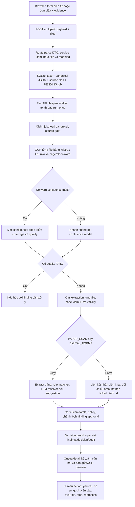

# Tổng hợp kiến trúc Hoangha và hướng kết hợp với final

Ngày đọc: 14/10/2026. Snapshot Hoangha: `1ee33487e2770ebd9e5ae65b994bbd3f3a4dd7a8`. Đây là tổng hợp của lead từ các báo cáo module, source kiểm tra chéo và đề thi. Kết luận về cơ chế là **source-verified**; tests, browser và provider LIVE **NOT_RUN** trong nhiệm vụ này.

## 1. Hoangha thực sự gồm những gì

Hoangha có hai application path cùng dùng một số adapter OCR/LLM nhưng khác miền nghiệp vụ, repository và lifecycle:

| Đường chạy | Entrypoint | Nghiệp vụ đang nối | Storage | Đầu ra |
| --- | --- | --- | --- | --- |
| FastAPI UC03 | `app.fastapi_app:app` | Nộp form/scan, OCR/extract, ghép chứng từ, kiểm quyết toán, kế toán can thiệp | SQLite + source/artifacts filesystem, `SET-*`, processing jobs | Settlement decision/finding, trạng thái workflow và review |
| Streamlit | `app/streamlit_app.py` | Nhận bill/context/support, quality OCR và đối chiếu bill với nguồn nhận hàng/kiểm kê | Filesystem, `CASE-*`, submission/OCR/processing/audit | `PASS` hoặc `NEEDS_HUMAN` trong phạm vi kiểm tra này |

Source: [FastAPI entrypoint](../../../.worktrees/hoangha/app/fastapi_app.py) dòng 27–62, [composition root](../../../.worktrees/hoangha/app/web/runtime.py) dòng 28–72, [Streamlit](../../../.worktrees/hoangha/app/streamlit_app.py) dòng 39–99. Các file Markdown kiến trúc cũ chủ yếu mô tả Streamlit hoặc thiết kế mục tiêu; xem [12](12-competition-and-integration.md).

## 2. Workflow UC03 từ đầu vào đến kết quả

Sơ đồ là wiring đọc từ source, không phải execution capture. Source: [processor](../../../.worktrees/hoangha/src/invoice_referee/application/process_settlement.py) dòng 146–238, 240–533, 535–1008; [route](../../../.worktrees/hoangha/app/web/routes.py) dòng 730–795; [repository](../../../.worktrees/hoangha/src/invoice_referee/storage/sqlite_settlement_repository.py) dòng 329–660.

### Những điều phải đọc đúng

1. **Source gate có thể kết thúc trước OCR.** Hoangha gọi một phần settlement policy trước đọc tài liệu. Vì vậy không phải mọi request nhận vào đều thực sự gọi OCR.
2. **OCR được gọi cho các file trong document pipeline**, kể cả PDF có text; Mistral adapter chọn `document_url` cho PDF và `image_url` cho ảnh. Digital form fields bản thân là dữ liệu có cấu trúc, không được OCR. Định dạng tầng submit rộng hơn định dạng pipeline xử lý; xem [01](01-domain-config.md), [02](02-ocr-quality.md), [05](05-storage-lifecycle.md).
3. **Không có candidate thì không gọi confidence LLM.** Điều đó chỉ nói về cách chọn candidate. Nó không chứng minh toàn bộ dữ kiện đã chính xác hoặc mọi critical word có numeric score.
4. **Classification và extraction Hoangha hiện gộp trong một output.** Final §15 đã chọn hai stage riêng, `UNKNOWN` giữ unresolved. Đây là khác biệt cần adapter, không chỉ đổi tên model Kimi.
5. **PAPER và FORM không dùng cùng amount reconciliation.** PAPER có matcher và cách loại payment proof khỏi một số tổng; FORM dựa vào linked item và có đường cộng mọi tài liệu.
6. **Cuối pipeline Hoangha đã có policy và chênh lệch tiền.** Khi port evidence stage hiện tại, phải dừng trước phần này. Mục tiêu dài hơn vẫn là nối evidence report đó vào workflow nghiệp vụ final bằng một hợp đồng admissibility riêng.

### Ví dụ TC01 để hiểu dữ liệu qua từng lớp

Đây là walkthrough **từ gold và source**, không phải một run đã thực hiện trong lượt này. Corpus v1 TC01 có request `report_hoan_ung.pdf`, evidence `hoa_don_dien_tu.pdf`; gold ghi tổng dòng/tổng form/invoice đều 3.240.000 đ, ứng khai 4.000.000 đ, chênh lệch in trên form 760.000 đ. Gold v1 gọi routine `AUTO_PROCESS` và follow-up `PENDING_APPROVAL`.

| Lớp | Dữ liệu có nghĩa gì | Điều không được suy vượt |
| --- | --- | --- |
| File gốc | Tài liệu chứa lời khai và hóa đơn | Chưa biết OCR đã đọc đúng hay payer/ứng thực nhận đã được xác minh |
| OCR | Văn bản, trang, block, word confidence của từng file | High score không tự chứng minh literal fact hoặc tiền đã chuyển |
| Extraction | Paper rows/advance/printed difference và expense invoice facts | `advance_amount=4.000.000` là số đọc trên giấy, chưa là event tài chính |
| Matching | Evidence thuộc dòng nào, score/method/ref, tổng tài liệu gốc | `AUTO_LINK` không thay kiểm số học, scope, payer hoặc policy |
| Hoangha policy/completion | Nếu gates đều rõ, code kiểm tổng/chênh lệch và đưa routine tới `READY_FOR_APPROVAL`/pending approval | Chưa ghi nhận nhân viên đã hoàn 760.000 đ; không có transfer/cash execution ledger cho việc đó |
| Final evidence boundary | Giữ analysis/link/report ở `EVIDENCE_READY` | Chưa gọi admissibility/finance, chưa tạo financial instruction |
| Final workflow mục tiêu | Khi E/A/P/R đủ căn cứ và trong quyền, tính S và tạo yêu cầu thu/chi | Không gắn amount trên form thẳng thành actual A, không gọi yêu cầu thu là tiền đã thu |

Ví dụ giúp phân biệt **đọc đúng số**, **ghép đúng khoản**, **đủ điều kiện hoàn trả** và **tiền đã thực hiện**: đó là bốn vấn đề khác nhau, cần bốn loại bằng chứng khác nhau. Việc kết hợp hai codebase phải giữ được các ranh giới này.

## 3. LLM, code và con người giữ quyền gì

| Việc | Model làm | Code làm | Giới hạn cần giữ |
| --- | --- | --- | --- |
| OCR | Mistral đọc nội dung trang, block, word/bbox/confidence | Chọn document/image request; lưu/restructure | OCR output có thể sai; high confidence không là chứng minh tài chính |
| Confidence | Kimi đánh giá low-confidence block, field mapping và có cần xác minh | Chọn candidate, kiểm đúng một assessment/candidate, quyết blocking | Không tự chữa literal OCR hoặc dùng nguồn khác để bù fact |
| Extraction | Kimi tạo typed paper/expense facts từ OCR | Pydantic, document ID, required/format/validity | Schema-valid chưa đủ chứng minh quote, payer, payment hay activity link |
| Matching | Kimi chỉ xuất hiện ở suggestion resolver | Normalize/score/threshold/reuse demotion, nhận candidate theo threshold | LLM `confidence>=0.90` không được giải thích là calibration đã đo |
| Policy/tiền | Prompt cấm model tự quyết | Decimal, caps, deadline, guard, difference | Policy Hoangha khác final; khai tiền ứng không tự là giao dịch thực nhận |
| Ngoại lệ | Model hỗ trợ đọc/giải thích | Finding/target/question và lưu action | Con người phải có đúng trách nhiệm/quyền; default persona không là authority |

Model được gọi bằng OpenAI-compatible adapter không làm kiến trúc phụ thuộc bắt buộc vào Kimi. Giữ ý tưởng và hợp đồng, dùng provider final đã chốt, đồng thời đánh giá lại chất lượng model sau chuyển đổi.

## 4. Các vấn đề trọng yếu trước khi mang sang final

Các finding dưới đây phân biệt lỗi hành vi, shortcut được công bố và mismatch của hợp đồng tích hợp. Chưa có runtime reproduction trong lượt này.

| Ưu tiên | Trigger và tác động cụ thể | Căn cứ | Disposition của lead |
| --- | --- | --- | --- |
| Cao | STOP khi job PENDING/RUNNING: repository vẫn claim/complete job và ghi decision; không có guard basis/version tại complete | [05 §4](05-storage-lifecycle.md), repository dòng 528–660; review dòng 88–100 | Đã kiểm tra source. Phải giữ Stop/job/basis của final; không port lifecycle này |
| Cao | Override của con người trong lúc job chạy có thể bị kết quả agent về sau thay current decision | Cùng completion không check expected basis/STOP; [05](05-storage-lifecycle.md) | Là hệ quả source của thiếu conditional commit, chưa chạy concurrency test. Cần test race ở tích hợp |
| Cao | DIGITAL_FORM gắn invoice và payment proof cùng khoản: hai amount được cộng, tạo mismatch giả | [04 F-01](04-settlement-matching-policy.md), processor dòng 918–1002 | Không port FORM reconciliation cũ; tổng chi phí và căn cứ thanh toán là hai vai trò |
| Cao | Warning typo trên đơn được validity coi non-blocking, `_finish_paper_case` lại đổi mọi warning thành FAIL | [04 F-02](04-settlement-matching-policy.md), processor dòng 593–607 | Giữ một severity/issue authority, tránh chuyển người thừa |
| Cao | LLM resolver promote suggestion có amount lệch, chỉ kiểm candidate/score; không chạy lại amount check PAPER sau promotion | [03 F03-1](03-llm-contracts.md), processor dòng 857–915 | Đã kiểm tra promotion, removal và caller. Giữ accepted risk và đo; baseline không bị block. Chỉ hỏi/chốt lại trước đổi semantics matching đã chốt |
| Cao | Removal matching FAIL keyed theo document có thể xóa câu hỏi row khác chưa được promote | [04 F-06](04-settlement-matching-policy.md), processor dòng 877–914 | Adapter phải giữ pair-specific issue/result; không xóa ambiguity bằng document ID chung |
| Cao | Public accounting action/delete/internal process có thể ghi mutation mà không server actor/grant boundary | [06 F1–F3](06-fastapi-frontend.md), routes dòng 675–728, 867–869 | Public demo access tương thích server-scoped demo actor. Không mang raw mutation routes sang final |
| Cao khi tích hợp | Số ứng do nhân viên nhập/đơn khai được dùng trực tiếp, thiếu kiểm trách nhiệm, binding và history/coverage | [04 §9.4](04-settlement-matching-policy.md), [06 F4](06-fastapi-frontend.md) | Giữ như declaration; admissibility theo final §14/ADR007. Không khẳng định mọi employee confirmation bị cấm |
| Vừa | Missing critical fields vẫn có thể `CLEAR/eligible_for_matching`; E-INVOICE có special-case vá, type khác không đồng nhất | [04 F-03](04-settlement-matching-policy.md) | Port profile/importance tables, viết lại gate theo FieldState/provenance |
| Vừa | Thiếu model/key trở thành COMPLETED + accountant finding, nhưng outage khác thành PROCESSING_ERROR | [04 F-04](04-settlement-matching-policy.md) | Tách technical failure khỏi business escalation, đặc biệt trong scorer |
| Vừa | Không có lease/recovery cho RUNNING; reprocess có thể tạo nhiều active jobs; DB/files publish có crash window | [05 §4](05-storage-lifecycle.md) | Dùng durable job/lifecycle hiện có của final và test các boundary này |
| Vừa | Threshold processing có cấu hình nhưng OCR view tái diễn giải cố định 0.85 | [06 F7](06-fastapi-frontend.md) | UI đọc persisted assessment hoặc server canonical threshold |
| Vừa | Draft/items có currency nhưng tổng cộng số thuần; authority check chỉ chặn khi draft currency VND, nhánh else báo PASS | [01 F01](01-domain-config.md), settlement policy dòng 322–336 | Boundary final chỉ nhận VND; không port mixed-currency sum hoặc coi non-VND trong quyền |
| Cao cho tooling | QA xóa thư mục `--output` đã tồn tại trước khi kiểm corpus, không có destructive flag | [09 F09-01](09-data-tooling.md), QA dòng 46–58 | Không dùng runbook QA này nguyên trạng; đây là source finding, chưa thực thi thao tác xóa |
| Vừa cho tái lập | Generator/QA dùng Windows fonts và dependency tooling chưa được package khai báo đủ | [09 F09-02/F09-03](09-data-tooling.md) | Làm portable dependency/font/output contract trước regenerate; không cần sửa runtime vì tooling khác scope |

### Điểm tôi không đồng ý coi là lỗi cần sửa ngay

- **Exact normalized reference → score 1.0** là trade-off core đã chọn. Nó chứng minh cùng identifier, không chứng minh đúng issuer/content/amount. Giữ risk visibility và downstream checks; không tự đổi scorer/threshold trong review này.
- **Demo không có ngân hàng chuyển tiền thật** phù hợp phạm vi. Vấn đề là phải phân biệt yêu cầu chi/thu, thực hiện tiền và số đã xác minh.
- **Synthetic persona** phù hợp demo nếu công bố. Vấn đề là client payload/persona không tự cấp quyền hoặc chứng minh danh tính người thao tác.
- **Policy 100 triệu/30 ngày/caps của Hoangha** không sai chỉ vì khác final. Nó thuộc một rulebook khác và không được nhập làm policy final.
- **Pydantic-valid** là safeguard cần thiết, nhưng các ràng buộc về nguồn, quan hệ và quyền vẫn cần code kiểm riêng. Không đánh đồng schema validation với groundedness.
- **Gold sinh cùng case definition với PDF** vẫn có thể là synthetic ground truth hữu ích cho extraction và regression. Vấn đề là tính độc lập của benchmark/rule labels, lỗi renderer/definition có thể tự nhất quán, và thiếu holdout; không kết luận mọi gold tổng hợp vô giá trị.
- **`UC03_DOCUMENT_PIPELINE_ENABLED`** đang được composition root Hoangha đọc thật, nên không phải dead config ở Hoangha. Khi port final cần mapping sang provider-mode contract, không tự gọi việc tồn tại một feature flag là bug.

## 5. Nên kết hợp phần nào

| Thành phần Hoangha | Hướng dùng trong final | Việc phải làm ở boundary |
| --- | --- | --- |
| Mistral request + raw OCR persistence | Tái dùng cơ chế all-file OCR | Ownership theo tenant/root/source/config, mọi trang, artifact limits và không native fallback |
| Word/block mapper + candidate coverage | Tái dùng dưới evidence pipeline | Missing score/unmapped critical field unresolved; không confidence mặc định PASS |
| Prompt/schema extraction | Tham khảo và chuyển sang provider final | Classification trước extraction, typed states, exact quote/page/block và source ID code-owned |
| Document profiles/importance | Pin dữ liệu từ revision Hoangha | Không nhập company policy vào validity evidence-only |
| Matcher core | Port có regression/golden test | Deliberate projection differences: None không 0, support không original, không cộng trùng, allocation explicit |
| OCR preview + finding/source UI | Chuyển concept sang server view/React | Source ownership và quyền đọc, locator chính xác, nhận severity từ backend |
| 75 case UC03 + generator | Dùng làm development/reference có mapping | Input/gold tách, taxonomy không mở scope nghiệp vụ, lấy subset phù hợp rồi tạo oracle final |
| SQLiteSettlementRepository/ReviewSettlementService | Dùng để hiểu behavior và failure cases | Không thêm repository/lifecycle thứ hai; final owns actor/version/job/Stop/audit |
| Streamlit inventory path | Giữ reference kỹ thuật, không đưa vào core bản đầu | Không mở mua hàng/nhận hàng/tồn kho chỉ vì có prompt/code |

## 6. Đánh giá với mục tiêu cuộc thi

Hoangha có nền evidence processing thật trong source: upload được lưu, OCR/LLM được wire, rule matcher/policy chạy và finding có nguồn để người đọc xử lý. Đây là tài sản kỹ thuật đáng kết hợp.

Để đáp ứng đề A, phải chứng minh thêm các ranh giới mà source hiện tại chưa tự đủ để chứng minh:

1. Routine đủ căn cứ/in-scope đi đến kết luận và yêu cầu nghiệp vụ, không thêm approval review mặc định cho mọi routine.
2. Ngoại lệ chuyển đúng FACT/POLICY/AUTHORITY, hỏi đủ cụ thể và không biến provider failure thành business question.
3. Người có quyền can thiệp thật; Stop/late result/override giữ đúng state và audit.
4. Verify Core4/Escalation5 chạy cùng runtime, báo actual khác expected, với holdout độc lập và input mới.
5. Đánh giá model sau port: unsafe automatic completion, unnecessary escalation, source/link correctness, latency/cost và chất lượng câu hỏi. 75 gold tự sinh chưa thay thế kiểm thử độc lập.
6. Public vận hành, 3 người dùng thực tế, cải tiến từ phản hồi và báo cáo bất cập vẫn là yêu cầu có bằng chứng riêng; merge code không tự hoàn thành chúng.

## 7. Kết luận kỹ thuật

Hướng kết hợp tốt nhất là **một workflow final sở hữu case, quyền, jobs, tiền và audit; bên trong nó dùng pipeline hiểu chứng từ và matcher/profile được chuyển từ Hoangha**. Hai frontend, hai repository và hai policy đồng thời xử lý một hồ sơ sẽ làm nguồn sự thật phân đôi.

Plan evidence hiện tại là giai đoạn đầu của việc kết hợp. Kết quả đọc code này xác định các regression và adapter cần bổ sung; nó chưa triển khai merge hoặc nối admissibility vào finance. Những đề xuất thay accepted matching predicate phải có disposition rõ trước implementation; review không tự ghi đè lựa chọn đã chốt.

Metadata corpus cần đọc đúng: v1 gắn 10 `COVERED` + 15 `GAP_EXPECTED`; v2 gắn 43 `COVERED` + 7 `PLANNED`. Đây là nhãn tác giả trong generator, không phải 53 case pass hoặc 75 case đã được pipeline chạy.

## Peer-check và phiên bản tài liệu

[14-peer-check](14-peer-check.md) đã kiểm riêng các claim 03–06. Lead áp dụng correction EVIDENCE_READY thay WAITING, giữ PNG, phân biệt accepted-risk LLM promotion với lỗi pair cleanup, và giữ responsible confirmation có ngưỡng cho E. Các thay đổi repo final ngoài folder báo cáo trong khi review được bảo toàn; đây không phải audit source final toàn nhánh ở revision cuối.
