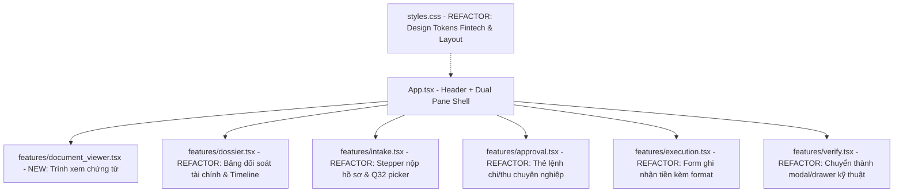

# Kế Hoạch Tái Cấu Trúc Toàn Diện UI/UX InvoiceReferee (Loại Bỏ "Mùi AI")

> **Mục tiêu:** Chuyển đổi giao diện `InvoiceReferee` từ dạng "AI boilerplate" (2 cột nhồi card, xả biến toán học $T, E, S$, menu ma, badge vô nghĩa) sang giao diện chuẩn **Fintech / Enterprise Expense Referee** với kiến trúc **Dual-Pane (Document Viewer 50% + Role-based Action Workspace 50%)**, bảng đối soát tài chính chuẩn mực kế toán và phân luồng tác vụ sâu sắc theo Persona.

---

## 1. Tóm Tắt Mục Tiêu & Bối Cảnh

### 1.1. Hiện trạng & Lý do cần Refactor
Giao diện hiện tại (`frontend/src/`) mắc phải 6 anti-pattern nghiêm trọng:
1. **Hội chứng xếp chồng card (Card Stacking)**: Dồn 5–6 form rời rạc vào cột trái, bắt người dùng cuộn dọc liên tục.
2. **Menu ma (Fake Nav)**: Thanh điều hướng trên Header là các thẻ `<span>` tĩnh, `cursor-default`, không có tác dụng.
3. **Lạm phát huy hiệu & Buzzwords**: Rải rác hơn 10 badge chấm màu vô nghĩa (`NAPAS 247 Ready`, `Hợp đồng §6`, `SHA-256 Verified`, `Contracts §7 & §11`).
4. **Dump biến toán học thô**: Danh sách số tiền hiển thị dạng $T, E, C, A, P, R, S$ như dict debug của lập trình viên, thay vì bảng đối soát tài chính (`Reconciliation Ledger`) chuẩn kế toán.
5. **Thiếu Document Viewer**: Một ứng dụng "Trọng tài hóa đơn" nhưng chỉ hiển thị chuỗi hash cắt ngắn, không có trình xem tài liệu trực quan, bắt nhân viên gõ tay `exact_quote`.
6. **Rò rỉ công cụ test nội bộ**: Component `<Verify />` với các chỉ số benchmark (`Dangerous miss`, `Union dangerous miss`) nằm lẫn vào màn hình nghiệp vụ hàng ngày.

### 1.2. Giải pháp Kiến trúc Sau Refactor
* **Header tinh giản & trung thực**: Giữ đúng vai trò nhận diện, breadcrumb hồ sơ, trạng thái hồ sơ thực tế, bộ chọn Persona chuyên nghiệp và chỉ báo môi trường (`LIVE` / `RECORDED_REPLAY`).
* **Bố cục Dual-Pane Split Layout (50% - 50%)**:
  * **Cửa sổ Trái (Document & Evidence Inspector)**: Trình xem tài liệu/chứng từ có tab chọn (`01_HD_KhachSan.pdf`, `UNC_TamUng.pdf`...), hiển thị trạng thái OCR, các trường bóc tách trực quan (bounding box overlay mockup) và vùng kéo-thả upload tiện lợi.
  * **Cửa sổ Phải (Role-Based Action & Audit Workspace)**: Phân hóa theo Persona (Nhân viên: Stepper Intake; Kế toán: Bảng đối soát tài chính + Lập lệnh chi/thu + Ghi nhận tiền; Người duyệt: Phê duyệt ngoại lệ/hạn mức).
* **Bảng Đối Soát Tài Chính Kế Toán (Fintech Reconciliation Card)**: Thay thế danh sách $T, E, S$ bằng card đối soát chi phí có phân cấp trực quan, số chênh lệch $S$ hiển thị to rõ dạng Hero KPI (Hoàn tiền cho nhân viên vs Thu hồi công nợ).
* **Tách Biệt Công Cụ Debug**: Đưa `<Verify />` vào ngăn kéo (Drawer/Modal) hoặc tab "Kiểm chuẩn Kỹ thuật", không làm ô nhiễm không gian làm việc của người dùng nghiệp vụ.

---

## 2. Các Quyết Định Cần Người Dùng Duyệt (User Review Required)

> [!IMPORTANT]
> **Vị trí của widget `<Verify />`**: Trong bản refactor, widget này sẽ được chuyển thành một nút bấm nhỏ ở góc phải Header ("🛠️ Kiểm chuẩn / Benchmark") mở modal/drawer khi cần kiểm thử, thay vì chiếm một card lớn ở luồng thao tác chính.
> 
> **Giữ nguyên 100% Contract & Test IDs**: Các `data-testid` (`money-Tổng chi công việc`, `money-Ứng thực nhận`, `basis-expense:1`, `intake-submit`...) sẽ được giữ nguyên vẹn để 14 unit/integration test của frontend tiếp tục vượt qua 100%.

---

## 3. Bản Đồ File Thay Đổi (Proposed Changes)



---

### Component 1: Design Tokens & Base Styles

#### `[MODIFY] frontend/src/styles.css`
* Bổ sung bảng màu và biến CSS chuẩn Fintech:
  * Primary: Deep Navy `#0f172a` / `#1e293b`.
  * Accent / Positive: Emerald `#059669` (cho khoản hoàn tiền nhân viên / hợp lệ).
  * Warning / Attention: Amber `#d97706` (cho các ngoại lệ chờ xử lý / cần trả lời).
  * Danger / Clawback: Rose `#dc2626` (cho thu hồi công ty / lỗi).
* Nâng font-size cơ sở: 14px cho body text, 13px cho data rows; loại bỏ bệnh lạm dụng `text-[10px]`.
* Tạo lớp tiện ích cho Document Canvas và Bounding Box highlight.

---

### Component 2: Trình Xem Chứng Từ (Document & Evidence Inspector)

#### `[NEW] frontend/src/features/document_viewer.tsx`
* **Nhiệm vụ**: Cung cấp cửa sổ trực quan bên trái hiển thị danh sách chứng từ đính kèm của hồ sơ.
* **Tính năng**:
  * Tab chuyển đổi giữa các file (`hoadon.pdf`, `ve_may_bay.pdf`...).
  * Toolbar: Zoom, xoay, xem số trang, trạng thái OCR (Đã đọc toàn bộ trang / Độ tin cậy word-score).
  * Evidence Canvas: Hiển thị nội dung mô phỏng văn bản hóa đơn kèm các highlight box cho các trường quan trọng (Số tiền, Mã số thuế, Đơn vị bán, Ngày lập) liên kết với trích xuất.
  * Empty state: Vùng kéo thả file đẹp mắt (Drag & Drop Zone) khi hồ sơ chưa có chứng từ.

---

### Component 3: Bảng Đối Soát Tài Chính & Lịch Sử Xử Lý

#### `[MODIFY] frontend/src/features/dossier.tsx`
* **Loại bỏ**: Danh sách $T, E, C, A, P, R, S$ thô sơ.
* **Thay thế bằng Fintech Reconciliation Ledger**:
  * **Hero KPI Block**: Hiển thị số tiền chênh lệch $S$ to, rõ ràng:
    * Nếu $S > 0$: Card xanh lá *"Công ty chi trả cho nhân viên: +{S} ₫"*.
    * Nếu $S < 0$: Card màu cam *"Nhân viên hoàn lại công ty: -{|S|} ₫"*.
    * Nếu $S = 0$: Card xanh *"Hồ sơ đã cân bằng hoàn tất"*.
  * **Bảng Kê Chi Tiết (Chi phí vs Tạm ứng vs Khấu trừ)**:
    * Chi phí kê khai ($T$) & Chi phí hợp lệ ($E$).
    * Tạm ứng thực nhận ($A$).
    * Các khoản đã thanh toán thêm / hoàn trả ($P, R$).
    * Giữ nguyên các `data-testid="money-{label}"` để đảm bảo test cũ pass.
  * **Khối Căn Cứ Thanh Toán (Q32 & Độc lập)**: Card hiển thị người xác nhận và điều khoản minh bạch, không gây hiểu nhầm sang ngân hàng.
  * **Khối Việc Cần Xử Lý (Issues)**: Thiết kế dạng Callout action rõ ràng theo từng người xử lý (`employee`, `accountant`, `approver`).
  * **Timeline Lịch Sử Kiểm Toán**: Timeline dạng vertical line thanh lịch, phân biệt rõ người thao tác và hành động nghiệp vụ.

---

### Component 4: Tinh Chỉnh Các Form Tác Vụ (Intake, Execution, Approval, Questions)

#### `[MODIFY] frontend/src/features/intake.tsx`
* Chuyển form thành luồng Stepper 3 bước trực quan:
  * Bước 1: Chọn hoặc khởi tạo hoạt động công tác.
  * Bước 2: Tải lên chứng từ (với preview thumbnail/icon).
  * Bước 3: Khai báo khoản tự chi Q32 (chọn hóa đơn trực quan từ file đã tải, ô nhập tiền tự format dấu chấm hàng nghìn).
* Bỏ toàn bộ badge thừa. Giữ đúng các input label và logic submit nguyên vẹn cho test.

#### `[MODIFY] frontend/src/features/execution.tsx`
* Tự động format số tiền khi gõ (ví dụ: gõ `3240000` $\to$ hiển thị `3.240.000 ₫`).
* Xóa badge `NAPAS 247 Ready`. Thay thế bằng trường chọn phương thức chuyển khoản rõ ràng.

#### `[MODIFY] frontend/src/features/approval.tsx` & `questions.tsx`
* Thiết kế lại card chỉ thị và thẻ câu hỏi: có nút action rõ ràng, màu sắc phân cấp tương phản cao theo chuẩn WCAG AA.

---

### Component 5: Header, Khung Ứng Dụng & Widget Kiểm Chuẩn

#### `[MODIFY] frontend/src/features/verify.tsx`
* Đóng gói lại thành modal/slide-over drawer, kích hoạt bằng nút *"🛠️ Kiểm chuẩn (Test Suite)"* trên Header.
* Không còn hiển thị như một card nội dung chính chiếm không gian nghiệp vụ.

#### `[MODIFY] frontend/src/App.tsx`
* Xóa bỏ các tab Header chết (`cursor-default`).
* Tổ chức lại Layout thành **Dual-Pane Split Layout**:
  ```tsx
  <div className="h-[calc(100vh-48px)] flex overflow-hidden">
    {/* Cột trái: Trình xem chứng từ & tài liệu (50%) */}
    <div className="w-1/2 border-r border-slate-200 flex flex-col bg-slate-100/60 overflow-hidden">
      <DocumentViewer caseView={caseView} onFilesSelected={...} />
    </div>

    {/* Cột phải: Không gian thao tác theo vai trò & Đối soát (50%) */}
    <div className="w-1/2 flex flex-col overflow-y-auto custom-scrollbar p-5 space-y-5 bg-slate-50">
      {/* Dynamic role workspaces: Intake / Approval / Execution / Questions / Dossier */}
    </div>
  </div>
  ```

---

## 4. Kế Hoạch Kiểm Thử & Xác Nhận (Verification Plan)

### 4.1. Automated Unit & Integration Tests
Chạy toàn bộ test suite frontend hiện tại:
```bash
rtk proxy npm --prefix frontend test
```
* **Kỳ vọng:** **14/14 tests pass** (`role-workspaces.test.tsx`, `dossier.test.tsx`, `intake-submit.test.tsx`, `app-restore.test.tsx`).

### 4.2. Build Verification
Kiểm tra biên dịch production của frontend:
```bash
rtk proxy npm --prefix frontend run build
```
* **Kỳ vọng:** Exit code 0, không có lỗi TypeScript hoặc CSS syntax error.

### 4.3. Manual UI/UX Verification
1. Mở ứng dụng trong trình duyệt qua server Vite / FastAPI.
2. Kiểm tra layout 2 cột: Cửa sổ trái mở xem tài liệu; cửa sổ phải hiển thị đúng theo 3 persona:
   * **Nhân viên**: Thấy Stepper nộp hồ sơ, chọn file, form Q32, bảng đối soát. Không thấy form ghi nhận tiền.
   * **Kế toán**: Thấy bảng đối soát chi tiết, Hero Callout số tiền $S$, lệnh chi/thu, form chuyển khoản NAPAS.
   * **Người duyệt**: Thấy các ngoại lệ cần phê duyệt, không thấy form ghi nhận tiền.
3. Thử nghiệm nhập số tiền: kiểm tra tính năng tự động format hàng nghìn.
4. Mở modal "Kiểm chuẩn (Verify)" và kiểm tra chạy suite STUB bình thường.
