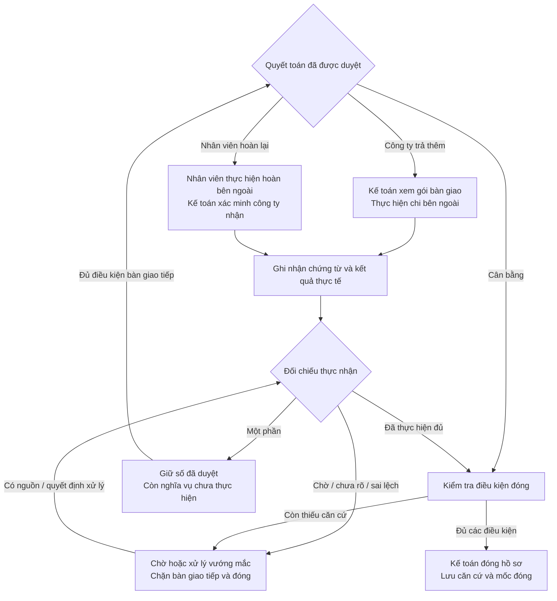

# B9 — Ghi nhận chi/thu và đóng quyết toán

Ngày 11/10/2026. **PLANNED**, tiếp nối
[B8](2026-10-11-b8-settlement-decision-design.md). Theo
[Product P4/P7](../../settlement/PRODUCT.md),
[Rulebook R4–R10](../../settlement/RULEBOOK.md),
[System S6/S7](../../settlement/SYSTEM.md). Chỉ baseline A: handoff là căn
cứ có audit; không tạo payment-request entity, không gửi lệnh ngân hàng.

## 1. Luồng tổng quan

Gói bàn giao chỉ cho phần còn lại đúng decision/scope/current rights, không
là chứng minh đã chi/thu. Không tự gọi ngân hàng, tự nhắc qua email, lập lịch
trả góp, tự thu thừa hoặc khấu trừ lương.

## 2. Nhận sự kiện tiền và bằng chứng

Kế toán đúng route nhập thông tin đã xảy ra: phương thức, economic namespace/
ref, gross, payer/payee, thời điểm, outcome và source/locator cho các trường
trọng yếu. Có thể thiếu/không rõ; lưu raw + classification, không ép đoán.
Nguồn do con người đọc ghi HUMAN_SOURCE_REVIEW, không bank-authenticated.

Proof source backend-owned `B7_SETTLEMENT_PROOF`, không vào Reader như invoice.
Upload proof không tự receipt. Extra arbitrary source_use của client không
cấp trust. Proof upload làm tăng case_version, không tự hủy decision; proof
mới chưa đối chiếu hiển thị cần xử lý và chặn action/closure khi material.

| Nội dung tiền | Cách dùng |
| --- | --- |
| Công ty trả thêm, nhân viên thực nhận | P — REIMBURSEMENT_RECEIVED |
| Nhân viên trả lại ứng, công ty thực nhận | RA — ADVANCE_RETURN |
| Nhân viên trả lại tiền hoàn trả đã nhận, công ty thực nhận | RP — REIMBURSEMENT_RETURN |
| Chưa rõ nguồn nghĩa vụ, vendor refund, sai bên nhận hoặc cách phân bổ | Giữ raw/issue; không nhét vào RA/P/RP |

Một collection event trong slice này chỉ có **một** mục đích RA hoặc RP đã
đủ căn cứ. Không tự chia receipt giữa RA và RP, không dùng cùng gross cho cả
hai. Mixed allocation giữ UNRESOLVED và nằm ngoài routine MVP. Không mặc định
mọi tiền nhân viên nộp là RA; report/decision/history phải chỉ ra đúng nghĩa vụ.

Receipt phải có source-supported amount VND/parties/event identity/time/
receiver outcome/work allocation. Company payee phải là công ty đúng cấu hình
`B7CompanyConfig.company_ref`, không chỉ khác employee. Thiếu company identity
chặn collection classification. Source xác nhận chỉ debit/SUBMITTED/Paid
không receiver outcome; vẫn PENDING/UNKNOWN. Cash receipt theo Rulebook R4,
không bắt sao kê ngân hàng cho tiền mặt hoặc checkbox tự chứng minh đã nhận.

Nhân viên có thể tải bằng chứng chuyển tiền qua source intake hiện có;
kế toán đọc/đối chiếu và ghi actual event. Receipt đã xảy ra vẫn nhận khi Stop
hoặc decision stale/chưa có, nhưng không tự fulfilled hoặc mở action mới.

## 3. Identity, correction và incidents

Idempotency command khác economic-event dedup. Namespace/ref và alias có
căn cứ dùng chung cho managed B5, B9 và company ledger. Cùng amount/date không
đủ SAME_EVENT. Exact replay không cộng thêm; contrad cùng event giữ cả nguồn
và incident; không upsert latest thắng. Event của work/decision khác không
fulfilled decision hiện tại.

Pending → received/failed/cancelled: source-backed status revision cùng
identity, explicit supersedes chỉ thay outcome nonfinal. Received → return/
reversal là economic event mới; không supersede receipt thành “chưa trả”.
Sửa sai số đã ghi ở final receipt giữ correction history, tạo material recheck;
không tự cho phép chi lại. Incident không có nút “đã xử lý” vô căn cứ.

Overpay4 so approved3: gross4, fulfilled3, excess1 incident; không clip raw4,
không tự collection decision1. Wrong recipient không employee/company receipt;
không auto chi bù. Unexpected money chưa gắn đúng scope/decision lưu raw/issue,
không làm giảm remaining. Failed/cancelled có nguồn đủ: không actual, không
auto retry; UNKNOWN khác failed hoặc zero.

## 4. Hai lớp tính tiền

**Whole work:** `S = E − (A − RA) − (P − RP)` từ canonical cumulative history
có coverage, refs, as-of/known-at. **Decision fulfillment:** số phê duyệt của
decision cụ thể, receipt hợp lệ thực hiện đúng nghĩa vụ, và phần còn lại.
Không lấy mọi PAYMENT_TO_EMPLOYEE trong case hoặc latest decision để cộng.

Baseline components lưu tại B8. Receipt đã nằm trong P/RA baseline không
được tính fulfillment mới; ledger import cùng receipt không cộng lần hai.
Correct new receipt đối chiếu với nghĩa vụ được duyệt làm giảm remaining,
không thay approved3 thành2 hoặc tạo approval mới mỗi lần report S giảm.

Không receipt canonical đã biết: received_vnd null; fulfilled có thể là0
trong managed decision scope nếu đã kiểm rõ chưa có managed receipt, nhưng
đó không proof whole P/RA0. Pending/unknown/incidents ảnh hưởng giữ remaining
null hoặc không executable; UI giữ subtotal đã rõ, không “còn0” màu xanh.
Gross thực nhận khác fulfilled capped theo approved; raw luôn giữ nguyên.

After-base outcome có thời điểm vượt report cutoff vẫn lưu, hiển thị ngoài
mốc và không nhét vào report cũ. Kế toán cập nhật coverage/snapshot tới mốc
mới, rerun qua cùng pipeline. App-owned receipts không tự mở rộng coverage
của sổ ngoài app. Thiếu opening/method/group/date vẫn unknown, không “managed
đủ” thay “whole-work đủ”. Clocks server/demo explicit, không backdate để đóng.

Decision vẫn dùng được nếu recheck chứng minh chỉ có correct fulfillment;
E/eligibility/payer/budget/policy/điều kiện không đổi và history delta chỉ gồm
receipts hợp lệ đã phân bổ. Raw proof mới, source mâu thuẫn, extra advance,
return/reversal hoặc khoản chi mới là material; giữ NEEDS_RECHECK. Không dùng
input_revision toàn bộ làm tiêu chí duy nhất, cũng không hash mọi tiền ra
ngoài basis để bỏ qua thay đổi. Lưu revalidation audit với old/new report và
receipt IDs; không sửa decision gốc.

## 5. Bàn giao và Stop

Handoff mới kiểm current B8 decision/basis/route/rights tại action time,
remaining>0, đúng direction, source coverage và không pending/incident/Stop
của child hoặc parent. Trả ID, decision/report/receipt/source refs, amount
remaining, expiry/currentness caveat và audit. BALANCED không handoff tiền.
Không có payment-request table/entity/status CREATED=PAID.

Hai lần bấm cùng command replay. New key cùng decision+obligation revision+
remaining trả cùng current handoff; history giữ các bản cũ. Receipt đúng làm
handoff cũ cần kiểm lại phần còn; new handoff đúng phần mới, không phát lại3.
Stop/resume không gọi provider/bank retry và không revive handoff cũ tự động.
App không bảo đảm ngăn con người dùng bản in cũ chuyển tiền ngoài app.

## 6. Đóng hồ sơ

Kế toán đúng route chủ động **Đóng hồ sơ quyết toán**, không auto-close sau
record, không nhận basis text làm căn cứ duy nhất. Backend kiểm trong cùng
transaction và lưu closure snapshot immutable trong audit.

Tất cả phải đạt:
1. Current sourced report sau các material money/source changes; whole scope
   đầy đủ, E/T/B/history đúng và calculated S=0, không unknown-as-zero.
2. B8 approval/BALANCED đúng scope, quyền tại decision/action times có căn cứ;
   correct fulfillment được revalidated, không tự thay/refuse decision cũ.
3. Nghĩa vụ approved đã đủ confirmed actual receipt; no remaining/pending/
   unknown/unallocated/incidents/reversal/vendor refund còn vướng.
4. No required source/quality/policy/authority/question unresolved và không
   parent/child Stop/stale context. Current scoped coverage tới closing as-of.
5. Expected version/current signatures và actor đúng route được kiểm lại lúc ghi.

S0 một mình không sufficient. REFUSE còn A/P/duties không đóng. B9 slice
không mở generic REJECTED_REQUEST_ENDED shortcut trên linked settlement;
trạng thái từ chối có nghĩa vụ giữ để xử lý. BALANCED + valid decision + mọi
gate sạch đóng được mà không tạo receipt0.

Closure ghi close_as_of/knowledge_cutoff, scope, original decision, current
report/revalidation/source/event refs và signatures/actor/time. Chỉ child
settlement được đóng; B3/B5 history không bị đổi job/ghi fake closure. Parent
UI có thể đọc nhãn “Quyết toán liên kết đã đóng”, không cho rằng mọi nghĩa vụ
khác của nhân viên cũng đóng.

## 7. Bằng chứng sau đóng

Không sửa closure cũ. Kế toán chọn **Tạo hồ sơ điều chỉnh** với reason và
nguồn mới; backend cấp child B7 cùng employee/work/B3, origin_link thêm
`adjustment_of_case_id` trỏ settlement đã đóng. Một active settlement trong
scope; concurrent requests reuse/conflict, không nhân đôi nghĩa vụ.

Carry cumulative history và receipts canonical đã có, sources cần thiết
được retained refs/copies; không reset A/P về0 và không chi lại toàn report.
Không tự approve/deduct/debit: điều chỉnh chạy B6/B7→B8 như hồ sơ mới.
Exact copy không lý do material không tạo adjustment tự động; explicit
adjustment không có thay đổi phải hiển thị không có nghĩa vụ mới, không
claim OCR phân biệt được mọi gian lận. Chưa hỗ trợ vendor-refund allocation
phức tạp thì giữ incident; không chọn formula tiện để đóng.

## 8. UI và acceptance

Kế toán thấy **Đã duyệt / Đã đối chiếu thực nhận / Còn phải thực hiện / Vướng
mắc**, direction cụ thể và căn cứ. Nhân viên thấy phải nhận/hoàn bao nhiêu,
đã được đối chiếu bao nhiêu và chờ ai. Người duyệt xem decision/history,
không thao tác ghi receipt. Debug IDs/modes vào details; thiếu gate có lý do
gần nút, không stack mọi role forms trong một màn.

Acceptance: pay3→receive2→remaining1→receive1→whole S0→close; collection0.7
đúng company receipt RA→close; BALANCED không event0; pending/unknown/failed/
wrong company/wrong employee/overpay/alias duplicate/material changes/Stop/
expired new-action grant/closure race đều đúng. Adjustment giữ old close,
carry receipts và không pay lại. Test APIs + restart + UI từng checkpoint.

Fake/replay khác LIVE/financial authentication. Không trả tiền thật, không
LIVE-provider calls/Git/publish. UI chưa thao tác ghi USER_UI_UNEXECUTED.
